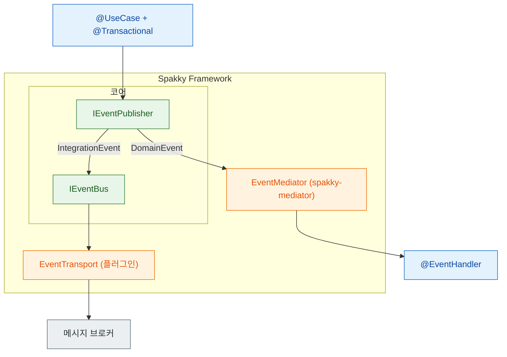

# 이벤트 시스템

> 도메인 이벤트와 통합 이벤트를 발행하고 handler로 처리하는 기본 흐름을, 개념과 사용법으로 나누어 설명합니다.

도메인 이벤트를 자동으로 발행하고 핸들러에서 처리하는 이벤트 기반 아키텍처를 구축합니다. events·outbox·saga가 하나의 분산 워크플로우로 맞물리는 전체 그림은 [이벤트 기반 아키텍처 통합 가이드](event-driven.md)를 참고하세요.

!!! warning "9.0.0부터 로컬 이벤트 제공자 분리"
    Domain Event를 로컬에서 처리하려면 `spakky-mediator`를 설치하고 로드해야 합니다. `spakky-event`와 `spakky[event]`는 로컬 제공자를 포함하지 않습니다. 기존 앱의 설치·플러그인 선택·import 변경은 [9.0 마이그레이션](events-migration.md)을 참고하세요.

---

## 개념

### 두 가지 이벤트 타입

| 이벤트 타입 | 전달 경로 | 용도 |
| --- | --- | --- |
| `AbstractDomainEvent` | 인프로세스 (`EventMediator`) | 같은 바운디드 컨텍스트 내 상태 변경 알림 |
| `AbstractIntegrationEvent` | 메시지 브로커 (`IEventBus` → RabbitMQ/Kafka) | 서비스/컨텍스트 간 통신 |

두 타입은 모두 `spakky.domain.models.event`에 정의되어 있고, `event_id: UUID`와 `timestamp: datetime`을 자동으로 가집니다. 정의 방법과 공통 속성, AggregateRoot의 이벤트 수집은 [이벤트 시스템 심화](../event-system.md)에서 다룹니다.

### 발행 라우팅

`IEventPublisher.publish()`는 단일 발행 진입점입니다. 이벤트 타입에 따라 인프로세스 핸들러(`EventMediator`)와 브로커(`IEventBus`)로 자동 라우팅합니다. 사용자 코드는 `publish()` 한 번만 호출하면 됩니다.



`@on_event` 핸들러는 이벤트 종류에 맞는 제공자가 자동 등록합니다. `spakky-mediator`는 `AbstractDomainEvent` 핸들러를 로컬 consumer에 등록하고, Kafka/RabbitMQ 플러그인은 `AbstractIntegrationEvent` 핸들러를 각 브로커 consumer에 등록합니다.

---

## 사용법

### 이벤트 핸들러 정의

`@EventHandler`와 `@on_event`로 이벤트 핸들러를 선언합니다.

#### 동기 핸들러

```python
from spakky.event.stereotype.event_handler import EventHandler, on_event

@EventHandler()
class OrderEventHandler:
    @on_event(Order.Created)
    def on_order_created(self, event: Order.Created) -> None:
        print(f"주문 생성됨: {event.order_id}, 금액: {event.total_amount}")

    @on_event(Order.ItemAdded)
    def on_item_added(self, event: Order.ItemAdded) -> None:
        print(f"아이템 추가: {event.item_name}")
```

#### 비동기 핸들러

```python
@EventHandler()
class AsyncOrderEventHandler:
    @on_event(Order.Created)
    async def on_order_created(self, event: Order.Created) -> None:
        await send_notification(f"주문 {event.order_id} 접수됨")

    @on_event(Order.ItemAdded)
    async def on_item_added(self, event: Order.ItemAdded) -> None:
        await update_inventory(event.item_name)
```

#### 같은 이벤트, 여러 핸들러

하나의 Domain Event에 여러 핸들러를 등록할 수 있습니다. `spakky-mediator`가 각 핸들러를 로컬 consumer에 등록합니다. Integration Event 핸들러의 자동 등록은 Kafka/RabbitMQ 플러그인이나 메모리 구현체가 담당하며, 구독자와 실패 처리 규칙은 [Integration Event 전달 계약](#integration-event-전달-계약)을 따릅니다.

```python
@EventHandler()
class NotificationHandler:
    @on_event(Order.Created)
    async def send_email(self, event: Order.Created) -> None:
        await email_service.send(f"주문 {event.order_id} 확인")

@EventHandler()
class AnalyticsHandler:
    @on_event(Order.Created)
    async def track_order(self, event: Order.Created) -> None:
        await analytics.track("order_created", event.total_amount)
```

### 트랜잭션과 연동해 발행

`@Transactional`과 함께 사용하면, 트랜잭션 커밋 후 이벤트가 자동 발행됩니다.

```python
from spakky.core.stereotype.usecase import UseCase
from spakky.data.aspects.transactional import transactional

@UseCase()
class CreateOrderUseCase:
    def __init__(self, order_repository: IOrderRepository) -> None:
        self._order_repository = order_repository

    @transactional
    async def execute(self, customer_name: str, total_amount: float) -> Order:
        # 1. Aggregate 생성 → 이벤트가 내부에 쌓임
        order = Order.create(
            customer_name=customer_name,
            total_amount=total_amount,
        )

        # 2. 아이템 추가 → 추가 이벤트
        order.add_item("노트북")
        order.add_item("마우스")

        # 3. Repository에 저장 → 내부에서 AggregateCollector.collect() 자동 호출
        return await self._order_repository.save(order)
        # 4. @Transactional 완료 시 → commit → 이벤트 자동 발행
```

### 타입별 발행 호출

```python
from spakky.event.publisher.domain_event_publisher import EventPublisher

# DomainEvent → Dispatcher → 인메모리 핸들러
domain_event = Order.Created(order_id=uuid4(), total_amount=1000)
publisher.publish(domain_event)  # EventMediator로 전달

# IntegrationEvent → Bus → 메시지 브로커
integration_event = OrderConfirmed(order_id="ORD-001", total_amount=5000)
publisher.publish(integration_event)  # RabbitMQ/Kafka로 전달
```

### 애플리케이션 설정

로컬 이벤트 제공자를 설치합니다.

```bash
uv add 'spakky[mediator]>=9.0.0'
```

아래는 트랜잭션 provider가 구성된 앱의 플러그인 선택 예시입니다. SQLAlchemy 등을 사용하면 해당 provider도 `include`에 유지합니다.

```python
import apps
import spakky.data
import spakky.event
import spakky.plugins.mediator
import spakky.tracing
from spakky.core.application.application import SpakkyApplication
from spakky.core.application.application_context import ApplicationContext

app = (
    SpakkyApplication(ApplicationContext())
    .load_plugins(include={
        spakky.data.PLUGIN_NAME,
        spakky.event.PLUGIN_NAME,
        spakky.plugins.mediator.PLUGIN_NAME,
        spakky.tracing.PLUGIN_NAME,
    })
    .scan(apps)             # @EventHandler 자동 검색
    .start()                # EventHandler ↔ 이벤트 타입 자동 매핑
)
```

!!! info "자동 등록"
    `app.start()` 시점에 `spakky-mediator`의 `EventHandlerRegistrationPostProcessor`가 Domain Event handler를 등록합니다. Integration Event handler는 선택한 Kafka/RabbitMQ 플러그인의 후처리기가 등록합니다. `spakky-event`의 `EventHandlerProviderValidationPostProcessor`는 각 handler에 맞는 제공자가 있는지 검증합니다.

---

## Integration Event 전달 계약

통합 이벤트 소비자(Kafka, RabbitMQ, 메모리 구현체)는 모두 `spakky-event`가 정의한 같은 전달 계약을 따릅니다. 배경과 결정은 [ADR-0024](../adr/0024-subscriber-delivery-contract.md)에 있습니다.

### 구독자

구독자는 이벤트 스트림을 독립적으로 읽는 단위입니다. 구독자마다 소비 위치, 재시도 상태, dead-letter 목적지가 따로이므로, 한 구독자의 실패나 지연이 다른 구독자를 막지 않습니다.

```python
from spakky.event.stereotype.event_handler import EventHandler, on_event


@EventHandler(subscriber="billing")
class BillingHandler:
    @on_event(OrderPlaced)
    async def charge(self, event: OrderPlaced) -> None: ...

    @on_event(OrderPlaced)
    async def issue_receipt(self, event: OrderPlaced) -> None: ...


@EventHandler(subscriber="shipping")
class ShippingHandler:
    @on_event(OrderPlaced)
    async def reserve(self, event: OrderPlaced) -> None: ...
```

- `subscriber`를 생략하면 이름 없는 구독자입니다. 구현체의 기본 식별자(Kafka `group_id`, RabbitMQ의 이벤트 이름 큐)로 읽습니다.
- 이름은 `[A-Za-z0-9][A-Za-z0-9_-]{0,62}`만 허용합니다. 어기면 선언 시점에 `InvalidSubscriberNameError`가 납니다.
- Domain Event는 인프로세스로 전달되므로 `subscriber`를 쓰지 않습니다.
- 한 구독(구독자와 이벤트 타입의 쌍)의 처리기는 모두 동기이거나 모두 비동기여야 합니다. 섞으면 기동 시 `MixedSubscriptionModeError`가 납니다. 동기·비동기 소비자가 같은 브로커 구독을 나눠 읽어 서로 메시지를 놓치기 때문입니다.

| 구현체 | 이름 없는 구독자 | 구독자 `billing` |
| --- | --- | --- |
| Kafka | consumer group `<group_id>` | consumer group `<group_id>.billing` |
| RabbitMQ | 큐 `<이벤트>` | 큐 `<이벤트>.billing` |
| 메모리 | 큐 `(<이벤트>, None)` | 큐 `(<이벤트>, "billing")` |

### 처리기 실행, 재시도, dead-letter

한 구독자 안에서 같은 이벤트의 처리기를 여러 개 둘 수 있습니다.

1. 한 처리기가 실패해도 나머지 처리기는 모두 실행합니다.
2. 실패한 처리기가 남으면 전달을 재시도합니다. 재시도는 아직 성공하지 못한 처리기만 실행합니다.
3. 시도 횟수를 다 쓰면 메시지를 그 구독자의 dead-letter 목적지로 옮깁니다.

재시도는 `RetryPolicy`가 정하고, 구독자마다 독립적으로 적용됩니다. 각 구현체 설정의 `retry` 필드로 지정합니다.

| 필드 | 기본값 | 의미 |
| --- | --- | --- |
| `max_attempts` | `1` | 첫 시도를 포함한 총 시도 횟수 |
| `initial_interval` | `0.0` | 두 번째 시도 전 대기(초) |
| `multiplier` | `2.0` | 실패할 때마다 대기에 곱하는 배수 |
| `max_interval` | `60.0` | 대기의 상한(초) |
| `mode` | `blocking` | `blocking`은 대기 중 뒤 메시지를 막아 순서를 지킵니다. `delayed`는 실패한 메시지를 옆으로 두고 뒤 메시지를 먼저 처리합니다 |

```bash
export SPAKKY_KAFKA__RETRY__MAX_ATTEMPTS=3
export SPAKKY_KAFKA__RETRY__INITIAL_INTERVAL=1.0
export SPAKKY_KAFKA__RETRY__MODE=delayed
```

재시도하지 않는 경우는 다음과 같습니다.

- `AbstractNonRetryableEventError`를 상속한 예외: 남은 횟수와 상관없이 바로 dead-letter로 갑니다.
- 본문을 이벤트 타입으로 역직렬화할 수 없는 경우: 바로 dead-letter로 갑니다.
- `EventDeferredError(retry_after)`: 시도 횟수를 세지 않고 기다렸다가 다시 전달합니다.
- 인가 거부(`AuthContextNotFoundError`, `AuthRequirementDeniedError`): 그 처리기만 건너뜁니다. RabbitMQ는 인가 실패 시 동작을 설정으로 바꿀 수 있습니다([RabbitMQ 가이드](rabbitmq.md)).

dead-letter 메시지는 원래 본문과 헤더에 다음 헤더를 더해 저장합니다. `DeadLetter.from_headers()`로 복원할 수 있습니다.

| 헤더 | 내용 |
| --- | --- |
| `x-spakky-dead-letter-original-destination` | 원래 발행된 이벤트 이름 |
| `x-spakky-dead-letter-subscriber` | 구독자 이름(이름 없는 구독자는 빈 문자열) |
| `x-spakky-dead-letter-failures` | 실패한 처리기별 예외 종류·메시지·재시도 가능 여부(JSON) |
| `x-spakky-dead-letter-attempts` | 시도 횟수 |
| `x-spakky-dead-letter-failed-at` | 마지막 시도가 끝난 시각(ISO 8601) |

순서 유지(`blocking`) 재시도의 진행 상태는 소비자 프로세스의 메모리에 있습니다. 프로세스가 재시작하면 그 메시지는 첫 시도로 다시 전달되고 모든 처리기가 다시 실행됩니다. 부작용이 있는 처리기는 아래의 멱등 소비를 함께 쓰세요.

### 다시 넣기 (redrive)

소비자는 `IEventRedriver`(비동기는 `IAsyncEventRedriver`)를 구현합니다. 다시 넣기는 dead-letter를 남긴 구독자에게만 전달하고, 실패로 기록된 처리기만 실행합니다. 같은 이벤트의 다른 구독자는 메시지를 다시 받지 않습니다.

```python
from spakky.event.redrive import IAsyncEventRedriver


async def retry_billing(redriver: IAsyncEventRedriver) -> None:
    result = await redriver.redrive(OrderPlaced, subscriber="billing", limit=100)
    print(result.succeeded, result.failed)
```

성공한 메시지는 dead-letter 목적지에서 빠지고, 다시 실패한 메시지는 그대로 남습니다.
실패로 기록된 처리기가 이름이 바뀌었거나 없어져 더 이상 등록돼 있지 않으면, 그 메시지는 성공으로 처리되지 않고 dead-letter에 남습니다(`EventHandlerNotRegisteredError`).

### 멱등 소비

브로커는 적어도 한 번 전달하므로 같은 이벤트가 다시 올 수 있습니다. `@Idempotent()`는 `(구독자, 처리기, event_id)`를 기록해 두고, 이미 처리한 이벤트의 처리기 본문을 건너뜁니다.

```python
from spakky.data.aspects.transactional import Transactional
from spakky.event.idempotency import Idempotent


@EventHandler(subscriber="billing")
class BillingHandler:
    @on_event(OrderPlaced)
    @Transactional()
    @Idempotent()
    async def charge(self, event: OrderPlaced) -> None: ...
```

- `@Transactional()`과 함께 선언합니다. 처리 기록은 처리기의 트랜잭션 안에서 본문보다 먼저 쓰이므로, 본문이 실패해 롤백되면 기록도 사라지고 다음 시도에서 다시 실행됩니다.
- 저장소는 `IProcessedEventStore`(비동기는 `IAsyncProcessedEventStore`)입니다. `spakky-sqlalchemy[event]`가 `spakky_event_inbox` 테이블 구현을 제공합니다. 저장소가 없으면 처리기 호출이 `ProcessedEventStoreUnavailableError`로 실패합니다.
- 처리기 이름의 기본값은 `<클래스>.<메서드>`입니다. 이름이 바뀌면 키도 달라지므로, 이름을 고정하려면 `@on_event(OrderPlaced, name="billing-charge")`처럼 지정합니다.
- 오래된 기록은 `purge(older_than)`으로 지웁니다. 보존 기간은 브로커가 같은 메시지를 다시 전달할 수 있는 기간보다 길어야 합니다.

### 브로커 없이 실행하기 (메모리 구현체)

메모리 구현체는 실제 직렬화를 거치고 같은 전달 계약을 따르므로, 브로커 없이 통합 이벤트 흐름을 테스트하거나 로컬에서 실행할 수 있습니다. 플러그인 엔트리 포인트가 아니므로 자동으로 켜지지 않습니다. 직접 호출해 켜고, 브로커 플러그인과 한 애플리케이션에서 함께 쓰지 않습니다.

```python
from spakky.event.memory.broker import InMemoryEventBroker
from spakky.event.memory.main import initialize as initialize_memory_broker

app = SpakkyApplication(ApplicationContext()).load_plugins(include={...})
initialize_memory_broker(app)
app.add(BillingHandler).add(ShippingHandler)
app.start()

broker = app.container.get(InMemoryEventBroker)
app.container.get(IEventPublisher).publish(OrderPlaced(order_id="o-1"))
await broker.drain_async()  # 처리기가 발행한 후속 이벤트까지 모두 전달

assert broker.dead_letters("OrderPlaced", "billing") == []
```

- `drain_async()`는 더 전달할 메시지가 없을 때까지 동기·비동기 처리기를 모두 실행합니다. `drain()`은 동기 처리기만 실행합니다.
- `app.start()` 뒤에는 백그라운드 소비자도 메시지를 전달합니다. 테스트에서는 `drain_async()`가 끝난 시점을 기준으로 검증하세요.
- `broker.published`, `broker.queued(...)`, `broker.dead_letters(...)`로 상태를 확인합니다.
- 재시도 설정은 `SPAKKY_EVENT_MEMORY__RETRY__*` 환경 변수로 지정합니다.
- 전파된 인증 스냅샷을 검증하지 않습니다. 인가가 필요한 처리기를 등록하면 기동 시 `InMemoryProtectedHandlerUnsupportedError`가 납니다.
- Outbox를 함께 쓰면 이벤트는 릴레이가 실행된 뒤에야 메모리 브로커에 도착합니다.

## 다음 단계

- [이벤트 9.0 마이그레이션](events-migration.md) — mediator 설치·선택, import와 consumer 역할 변경
- [이벤트 기반 아키텍처 통합 가이드](event-driven.md) — events·outbox·saga를 함께 쓰는 분산 워크플로우
- [이벤트 시스템 심화](../event-system.md) — 이벤트 정의, AggregateRoot 이벤트 수집, 인터페이스 구조
- [Transactional Outbox](outbox.md) — Integration Event의 원자적 기록과 성공 전달 경로의 at-least-once 의미

## 인프로세스 전용 구성과 후속 트랜잭션

Domain Event 처리에는 RabbitMQ/Kafka transport가 필요하지 않습니다. Integration Event를 외부로 발행할 때 transport를 설치하지 않았다면 `IntegrationEventTransportUnavailableError`로 거절합니다.

트랜잭션 이벤트 발행 Aspect의 Order는 0, TransactionalAspect의 Order는 1입니다. 이벤트 Aspect가 트랜잭션 실행을 감싸므로 commit 및 dispose 이후에만 성공 이벤트를 전달합니다. 수집 목록과 이벤트 배치를 분리한 뒤 핸들러를 호출하여 후속 유스케이스가 부모 이벤트를 재발행하지 않도록 합니다.

## 명시적인 이벤트 제공자 선택

`spakky-event`는 이벤트 계약·발행·Aspect와 제공자 검증을 소유합니다. 로컬 domain
consumer/dispatcher는 별도 `spakky-mediator` 플러그인을 설치하고 선택해야 합니다.
Kafka/RabbitMQ만 사용하는 서비스에는 로컬 mediator가 자동으로 등록되지 않습니다.
`spakky[event]`도 mediator를 숨겨 설치하지 않습니다.

| 구성 | 가능한 동작 |
| --- | --- |
| event | 계약과 발행 진입점; 없는 제공자로의 발행은 명시적 오류 |
| event + mediator | 동기·비동기 domain event 등록과 로컬 dispatch |
| event + Kafka | 동기·비동기 integration event 발행·소비 |
| event + mediator + Kafka | 두 이벤트 종류가 각 제공자로 독립적으로 전달됨 |

선언한 handler의 동기/비동기 및 domain/integration 역할에 맞는 consumer가 없으면
`EventHandlerProviderUnavailableError`로 기동을 실패시킵니다. domain 발행에 dispatcher가
없으면 `DomainEventDispatcherUnavailableError`, integration 발행에 transport가 없으면
`IntegrationEventTransportUnavailableError`를 발생시킵니다. 누락된 이벤트를 조용히 버리지 않습니다.

구현 import 이전과 설치 예시는 [Mediator API](../api/plugins/spakky-mediator.md)를 참고하세요.
