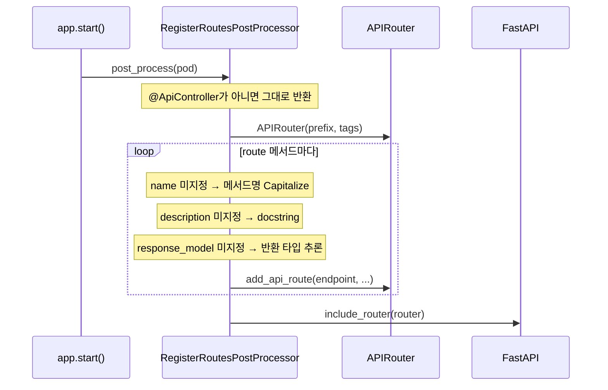

# FastAPI 심화

> `spakky-fastapi`의 라우트 등록 내부 동작과, 운영에서 필요한 커스텀 인스턴스·미들웨어·WebSocket·분산 트레이싱·Agent stream 노출을 다룹니다.

이 문서는 [FastAPI 통합](fastapi.md)의 기초(컨트롤러·라우팅·에러 매핑)를 읽은 뒤 확인하는 심화 가이드입니다. 기본 문서가 "동작하는 컨트롤러"에 집중한다면, 여기서는 등록 과정에서 무슨 일이 일어나는지와 채널 경계에서 자주 마주치는 고급 요구사항을 설명합니다.

## 라우트 등록 내부 동작 { #route-registration }

`app.start()`가 끝나기 전, `RegisterRoutesPostProcessor`가 모든 Pod를 순회하며 `@ApiController`가 붙은 Pod를 찾습니다. 컨트롤러 하나마다 `APIRouter`를 만들고, route 메서드를 `add_api_route()`로 등록한 뒤, 컨테이너에 등록된 모든 `FastAPI` 앱에 `include_router()`로 붙입니다.



`response_model`이 비어 있으면 메서드의 반환 타입 annotation으로 `create_model_field("", return_annotation)`을 시도합니다. FastAPI가 모델 필드를 만들 수 없는 타입(`str`·`dict` 등)이면 `FastAPIError`가 발생하고, 이 경우 `response_model` 없이 등록합니다. 따라서 응답 스키마를 OpenAPI에 노출하려면 반환 타입을 Pydantic 모델로 선언합니다.

등록된 endpoint는 요청마다 `ApplicationContext.clear_context()`를 호출해 CONTEXT scope Pod가 이전 요청과 섞이지 않도록 정리하고, 컨테이너에서 컨트롤러 인스턴스를 다시 resolve해 실제 메서드를 호출합니다. `spakky-auth`를 함께 쓰면 이 경계에서 인증 컨텍스트를 seed하고, `AbstractSpakkyAuthError`를 HTTP 응답으로 매핑합니다.

`response_class`가 `EventSourceResponse`이고 메서드가 generator이면 `response_model` 추론을 건너뛰고 [SSE stream](#sse)으로 등록합니다. 그 밖의 route 등록 방식은 달라지지 않습니다.

## 커스텀 FastAPI 인스턴스 { #custom-instance }

기본 앱 대신 직접 만든 `FastAPI` 인스턴스를 쓰려면 플러그인 로드 전에 Pod로 등록합니다. 플러그인은 컨테이너에 이미 `FastAPI` Pod가 있으면 기본 앱을 중복 등록하지 않습니다.

```python
from fastapi import FastAPI
from spakky.core.application.application import SpakkyApplication
from spakky.core.application.application_context import ApplicationContext
from spakky.core.pod.annotations.pod import Pod

import apps
import spakky.plugins.fastapi


@Pod()
def custom_fastapi() -> FastAPI:
    return FastAPI(title="Orders API", version="1.0.0")


spakky_app = (
    SpakkyApplication(ApplicationContext())
    .add(custom_fastapi)
    .load_plugins(include={spakky.plugins.fastapi.PLUGIN_NAME})
    .scan(apps)
    .start()
)
```

`RegisterRoutesPostProcessor`는 컨테이너에 등록된 **모든** `FastAPI` Pod에 라우터를 붙이므로, 여러 `FastAPI` 인스턴스를 등록하면 동일 컨트롤러가 각 앱에 등록됩니다.

## 미들웨어와 에러 처리 { #middleware-error }

`AddBuiltInMiddlewaresPostProcessor`가 `FastAPI` Pod에 기본 미들웨어를 주입합니다. `add_middleware`는 가장 나중에 추가한 미들웨어가 가장 바깥에서 실행되므로, 실행 순서(바깥쪽 우선)는 다음과 같습니다.

1. `TracingMiddleware` — W3C Trace Context 추출/주입 (트레이싱 propagator가 있을 때만)
2. `ErrorHandlingMiddleware` — 예외를 JSON 응답으로 변환

`ErrorHandlingMiddleware`는 `AbstractSpakkyFastAPIError`를 잡아 `to_response()`로 변환하고, 그 외 예외는 로그를 남긴 뒤 `InternalServerError`(500)로 응답합니다. `FastAPI(debug=True)`(또는 `SPAKKY_FASTAPI_DEBUG=true`)이면 500 응답에 traceback이 포함됩니다.

기본 에러로 표현되지 않는 상태 코드가 필요하면 `AbstractSpakkyFastAPIError`를 상속해 `status_code`와 `message`를 선언합니다.

```python
from typing import ClassVar

from fastapi import status
from spakky.plugins.fastapi.error import AbstractSpakkyFastAPIError


class PaymentRequired(AbstractSpakkyFastAPIError):
    message = "Payment Required"
    status_code: ClassVar[int] = status.HTTP_402_PAYMENT_REQUIRED
```

`message`는 클래스 속성으로 정의하고, 추가 컨텍스트가 필요 없으면 `__init__`을 오버라이드하지 않습니다.

## WebSocket

`@websocket` 데코레이터로 WebSocket 엔드포인트를 선언합니다. HTTP route와 마찬가지로 컨트롤러 메서드로 등록되며, 각 연결마다 컨텍스트가 격리됩니다.

```python
from fastapi import WebSocket
from spakky.plugins.fastapi.routes import websocket
from spakky.plugins.fastapi.stereotypes.api_controller import ApiController


@ApiController("/chat")
class ChatController:
    @websocket("/ws")
    async def chat(self, socket: WebSocket) -> None:
        """WebSocket /chat/ws"""
        await socket.accept()
        while True:
            message = await socket.receive_text()
            await socket.send_text(f"Echo: {message}")
```

## Server-Sent Events { #sse }

`@sse` 데코레이터는 컨트롤러의 generator 메서드, 또는 async iterator를 돌려주는 coroutine 메서드를
`text/event-stream` 응답으로 등록합니다.
인코딩·keep-alive·연결 종료 처리는 FastAPI의 `fastapi.sse`가 그대로 맡고, 새 의존성은 없습니다.

```python
from collections.abc import AsyncIterator

from fastapi.sse import ServerSentEvent
from pydantic import BaseModel
from spakky.plugins.fastapi.routes import sse
from spakky.plugins.fastapi.routes.route import HTTPMethod
from spakky.plugins.fastapi.stereotypes.api_controller import ApiController


class Progress(BaseModel):
    percent: int


class ExportRequest(BaseModel):
    report_id: str


@ApiController("/reports")
class ReportController:
    @sse("/{report_id}/progress")
    async def progress(self, report_id: str) -> AsyncIterator[Progress]:
        """GET /reports/{report_id}/progress"""
        for percent in (25, 50, 100):
            yield Progress(percent=percent)

    @sse("/exports", methods=[HTTPMethod.POST])
    async def export(self, body: ExportRequest) -> AsyncIterator[ServerSentEvent]:
        """POST /reports/exports"""
        yield ServerSentEvent(data={"report": body.report_id}, event="started", id="1")
        yield ServerSentEvent(raw_data="done", event="finished", id="2")
```

- 기본 HTTP 메서드는 GET이고 `methods`로 바꿉니다.
- `ServerSentEvent`를 yield하면 `event`/`id`/`retry`/`comment` 필드가 그대로 전송됩니다. `data`는 JSON으로 직렬화되고, `raw_data`는 그대로 `data:`에 들어갑니다.
- 그 밖의 값(dict, Pydantic model 등)을 yield하면 JSON으로 직렬화되어 `data:` 이벤트가 됩니다.
- 동기 generator도 쓸 수 있습니다. FastAPI가 thread pool에서 순회합니다.
- 이벤트가 15초 동안 없으면 FastAPI가 `: ping` keep-alive comment를 보냅니다. client가 연결을 끊으면 generator가 취소되므로 정리 코드는 `try`/`finally`에 둡니다.
- generator도 coroutine도 아닌 메서드에 `@sse`를 붙이면 `SseEndpointNotGeneratorError`가 발생합니다.
- `@get("/path", response_class=EventSourceResponse)`처럼 verb 데코레이터에 `EventSourceResponse`를 지정한 generator 메서드도 같은 방식으로 등록됩니다.

컨트롤러 resolve, context 초기화, `AuthContext` seeding, `Request` 주입은 일반 route와 같은 순서로
**stream이 시작되기 전에** 실행됩니다. 따라서 `@protected` SSE 메서드에 credential이 없으면
`200` stream이 아니라 `401` 응답이 나갑니다. 메서드 호출에 걸린 동기 aspect도 이 시점에 실행되며,
aspect가 감싸는 것은 generator를 만드는 호출입니다. 이벤트를 하나씩 순회하는 동안에는 aspect가
개입하지 않고, 본문 실행 중 발생한 예외는 이미 응답이 시작된 뒤이므로 HTTP 상태 코드로 바뀌지 않습니다.

### stream을 열기 전에 판정하기 { #sse-open }

stream을 열기 전에 조회나 권한 판정을 하고, 실패하면 HTTP 오류로 답해야 할 때는 `@sse` 메서드를
async iterator를 돌려주는 coroutine으로 씁니다. 등록은 두 단계입니다.

1. 응답이 시작되기 전에 coroutine을 `await`합니다. 이 호출은 FastAPI dependency로 실행되므로,
   여기서 발생한 예외는 일반 route와 같은 HTTP 오류 응답이 됩니다(예: `NotFound`는 `404`).
   컨트롤러 resolve, context 초기화, `AuthContext` seeding, `Request` 주입도 이 단계에서 일어나고,
   비동기 aspect도 이 호출을 감쌉니다.
2. coroutine이 돌려준 async iterator를 stream으로 보냅니다. 이벤트 인코딩, keep-alive, 연결 종료
   시 취소는 generator 메서드와 같습니다. 돌려준 값이 async generator이면 stream이 끝나거나 client가
   연결을 끊을 때 `aclose()`로 닫으므로 정리 코드는 그 generator의 `try`/`finally`에 둡니다.

```python
from collections.abc import AsyncIterator

from fastapi.sse import ServerSentEvent
from spakky.plugins.fastapi.error import NotFound
from spakky.plugins.fastapi.routes import sse
from spakky.plugins.fastapi.stereotypes.api_controller import ApiController


class JobNotFound(NotFound):
    message = "Job not found"


@ApiController("/jobs")
class JobController:
    def __init__(self, jobs: JobService) -> None:
        self.jobs = jobs

    @sse("/{job_id}/events")
    async def events(self, job_id: str) -> AsyncIterator[ServerSentEvent]:
        job = await self.jobs.find(job_id)
        if job is None:
            raise JobNotFound(job_id)  # stream 대신 404

        async def stream() -> AsyncIterator[ServerSentEvent]:
            async for change in self.jobs.changes(job):
                yield ServerSentEvent(data=change, id=str(change.seq))

        return stream()
```

- coroutine이 async iterator가 아닌 값을 돌려주면 `SseStreamNotAsyncIterableError`(`500`)로 응답합니다.
- 두 번째 단계에서 발생한 예외는 generator 메서드와 같이 HTTP 상태 코드로 바뀌지 않습니다.

### 서버 종료 때 stream 끝내기 { #sse-shutdown }

uvicorn은 SIGTERM을 받으면 새 연결을 받지 않고, 열린 응답이 모두 끝나기를 기다린 **뒤에** ASGI
lifespan 종료를 실행합니다. 스스로 끝나지 않는 stream은 그동안 프로세스를 붙잡고,
`timeout_graceful_shutdown`이 없으면 끝없이, 있으면 그 시간이 지나 연결이 끊길 때까지 종료가 늦어집니다.
lifespan 종료에서 stream을 멈추라고 알리면 이미 늦습니다.

플러그인은 서버가 종료를 시작하는 순간 열린 `@sse` stream을 정상 종료로 끝냅니다. 사용자 코드에 바꿀
것은 없습니다.

- lifespan이 시작될 때, 서버가 설치한 Python 수준의 SIGTERM·SIGINT handler 앞에 `ShutdownSignalRelay`를
  잇습니다. 신호가 오면 `ServerShutdownSignal`을 켠 뒤 서버의 handler를 그대로 부르므로 서버의
  종료 절차는 바뀌지 않습니다. handler가 `SIG_DFL`·`SIG_IGN`인 신호는 건드리지 않습니다. Python이
  SIGINT에 기본으로 두는 `default_int_handler`처럼 호출할 수 있는 handler는 모두 잇습니다. lifespan이
  main thread가 아닌 곳에서 돌면 handler를 잇지 않습니다.
- lifespan이 끝날 때도 `ServerShutdownSignal`을 켭니다. 신호를 잇지 못한 서버에서는 이 시점에 stream이
  끝납니다. 신호는 다음 lifespan이 시작될 때까지 켜진 채로 남습니다. 그래서 lifespan을 한 번 돌린 같은
  앱을 lifespan 없이 다시 쓰면(예: 테스트에서 `with` 없이 만든 `TestClient`) 새 stream이 이벤트 없이 바로
  끝납니다. 테스트에서는 lifespan을 함께 돌리거나 `ServerShutdownSignal.reset()`을 부릅니다.
- async generator와 coroutine이 돌려준 async iterator는 응답을 보내는 task 안에서 그대로 돕니다.
  그래서 `yield`를 감싸는 anyio cancel scope·task group, `asyncio.timeout`, `current_task()`에 묶인
  session, context variable token이 신호가 없을 때와 같이 동작합니다. 신호가 켜졌을 때 stream이 다음
  항목을 기다리는 중이면 그 대기만 취소하고, 항목을 보내는 중이면 그 항목을 보낸 뒤 멈춥니다. 그 순간 다른
  취소가 이미 task를 깨운 상태면 두 취소가 하나로 합쳐져 stream에 닿으므로, task가 다시 기다리기 시작할 때
  한 번 더 요청합니다. 그래서 stream 안의 cancel scope가 같은 순간에 자기 취소를 흡수해도 stream이 열린 채
  남지 않습니다. 따로 닿은 취소는 다시 요청하지 않으므로, stream이 취소를 잡은 뒤 기다리는 정리 작업은
  끝까지 실행됩니다. 다만 합쳐진 취소가 stream 바깥의 scope(예: client 연결 끊김)에서 왔다면, 흡수됐는지
  가릴 수 없어 다시 요청한 취소가 그 정리 작업을 끊을 수 있습니다. 취소에
  항목으로 답하는 stream이면 그 항목은 보내지 않습니다. 이어서 stream을 닫으므로 `finally`가 실행되고,
  응답은 오류 없이 끝납니다. client는 SSE의 `retry`에 따라 다시 연결해 다른 서버에 붙습니다.
- 기다리던 대기를 끊는 것은 asyncio 취소라서 anyio shield도 막지 못합니다. stream이
  `anyio.CancelScope(shield=True)` 안이나 `anyio.to_thread.run_sync`·Starlette `run_in_threadpool`을
  기다리는 중이어도 끊기고, worker thread는 하던 일을 계속하는 동안 `finally`가 먼저 실행됩니다. 그래서
  stream의 `finally`는 worker thread가 아직 쓰고 있을 수 있는 자원(DB session·connection, 파일, 공유
  buffer 등)을 닫거나 바꾸면 안 됩니다. 그런 자원은 worker thread 쪽에서 정리합니다. 종료 중에도 끝까지
  마쳐야 하는 작업은 stream 밖(예: background service)에서 합니다. 같은 순간에 들어온 다른 취소(client 연결 끊김 등)는
  삼키지 않고 그대로 전달합니다.
- 동기 generator는 thread pool에서 돌아 중간에 끊을 수 없습니다. 다음 항목을 만들거나 요청할 때
  신호를 확인하고 끝납니다. 오래 열어 둘 stream은 async generator로 씁니다.

`ServerShutdownSignal`은 Pod이므로 컨트롤러나 서비스에 주입해 종료 시작을 직접 확인할 수 있습니다.
`triggered`로 상태를 읽고, `await wait()`로 종료 시작을 기다립니다.

```python
from collections.abc import Iterator

from spakky.plugins.fastapi.routes import sse
from spakky.plugins.fastapi.shutdown import ServerShutdownSignal
from spakky.plugins.fastapi.stereotypes.api_controller import ApiController


@ApiController("/exports")
class ExportController:
    def __init__(self, shutdown: ServerShutdownSignal) -> None:
        self.shutdown = shutdown

    @sse("/{export_id}/rows")
    def rows(self, export_id: str) -> Iterator[ExportRow]:
        for row in read_export(export_id):  # 동기 I/O
            if self.shutdown.triggered:
                break  # 종료가 시작되면 다음 행을 읽지 않는다
            yield row
```

uvicorn을 쓴다면 `timeout_graceful_shutdown`도 함께 정해 둡니다. 신호를 잇지 못한 서버나 끝나지 않는
동기 작업이 있어도 종료 시간이 이 값으로 묶입니다.

## 분산 트레이싱 { #tracing }

`spakky-tracing`은 `spakky-fastapi`의 필수 의존성입니다. 컨테이너에 `ITracePropagator`가 등록되어 있으면 `AddBuiltInMiddlewaresPostProcessor`가 `get_or_none(ITracePropagator)`로 propagator를 조회해 `TracingMiddleware`를 자동 등록합니다.

- 수신 요청의 `traceparent` 헤더에서 `TraceContext`를 추출하여 자식 스팬을 생성합니다
- 헤더가 없으면 새로운 루트 트레이스를 시작합니다
- 응답 헤더에 `traceparent`를 자동 주입합니다
- 요청 완료 후 `TraceContext`를 자동으로 정리합니다

별도 설정이나 코드 변경 없이, 플러그인 로드만으로 동작합니다.

## AgentYield stream 노출 { #agent-stream }

`@Agent`는 inbound adapter에서 `@UseCase`처럼 container로 resolve한 뒤 `execute()`를 호출합니다. Agent 전용 FastAPI plugin package를 만들 필요는 없습니다. CodeAssistant demo의 WebSocket 예제는 `core/spakky-agent/examples/inbound_adapter_examples.py`에 있습니다.

```python
from examples.code_assistant_demo import CodeAssistant
from examples.inbound_adapter_examples import (
    agent_signal_from_json,
    agent_yield_to_event,
    code_assistant_command_from_json,
)
from fastapi import WebSocket
from spakky.agent import IAgentSignalRepository
from spakky.core.pod.interfaces.aware.container_aware import IContainerAware
from spakky.core.pod.interfaces.container import IContainer
from spakky.plugins.fastapi.routes import websocket
from spakky.plugins.fastapi.stereotypes.api_controller import ApiController


@ApiController("/agents")
class AgentController(IContainerAware):
    _container: IContainer

    def set_container(self, container: IContainer) -> None:
        self._container = container

    @websocket("/code/ws")
    async def code(self, socket: WebSocket) -> None:
        await socket.accept()
        command = code_assistant_command_from_json(await socket.receive_json())
        agent = self._container.get(CodeAssistant)
        signals = self._container.get(IAgentSignalRepository)

        async for item in agent.execute(command):
            await socket.send_json(agent_yield_to_event(item))
            if item.kind.value == "approval":
                signals.append(
                    agent_signal_from_json(
                        command.state_id,
                        await socket.receive_json(),
                        approval=item.payload,
                    )
                )
```

실제 예제는 inbound JSON을 `CodeAssistantCommand`와 `AgentSignal`로 변환합니다. 핵심은 WebSocket이 transport 변환만 담당하고, agent business workflow는 container에서 얻은 `CodeAssistant.execute()` 안에 남긴다는 점입니다.

SSE나 AG-UI/CopilotKit 연동이 필요하면 [AI Agent 개발](agents.md)의 SSE 및 AG-UI adapter 예제를 사용합니다. Spakky-native SSE는 `AgentYield`를 `data: {"kind": ...}` frame으로 보내고, CopilotKit용 endpoint는 AG-UI `data: {"type": ...}` event stream으로 별도 변환해야 합니다.
