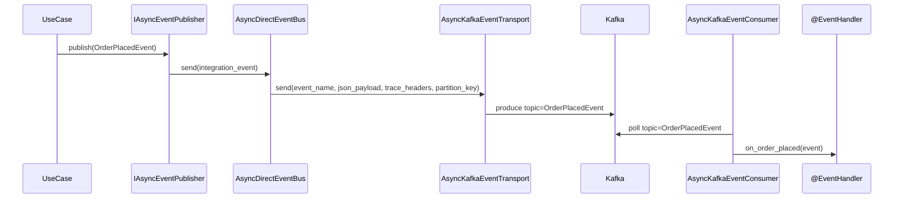

# Kafka 통합

> `spakky-kafka`는 `IEventTransport` 인터페이스를 통해 Integration Event를 Apache Kafka로 전송하고, 백그라운드 Consumer로 수신합니다.
> `AbstractIntegrationEvent.event_name` 값을 Kafka topic으로 사용하므로 발행자와 소비자가 같은 이벤트 타입 계약을 공유해야 합니다.

---

## 동작 원리

1. `@EventHandler`의 `@on_event` 메서드가 `KafkaPostProcessor`에 의해 Consumer에 자동 등록
2. Integration Event 발행 시 `KafkaEventTransport`가 Kafka 토픽으로 전송
3. `KafkaEventConsumer`가 백그라운드 서비스로 토픽을 소비하며 핸들러에 dispatch

Transport는 producer를 발행마다 새로 만들지 않고 하나를 재사용합니다. 비동기 transport는 애플리케이션이 서비스를 시작할 때 producer를 열고 종료할 때 닫으므로, 브로커 연결과 메타데이터 조회가 발행마다 반복되지 않고 producer 단위 설정(배치·멱등 발행)이 수명 내내 유지됩니다. 시작 시점에 브로커에 연결하지 못하면 `app.start()`가 실패하며, 애플리케이션 수명 밖의 발행은 `EventTransportNotRunningError`로 거부됩니다.

---

## 설정

`KafkaConnectionConfig`는 `@Configuration`이므로 환경변수에서 자동 로딩됩니다.
발행 예제는 `IAsyncEventPublisher`와 event bus를 사용하므로 `spakky-kafka`와 함께 `spakky-event`를 설치하고 로드해야 합니다. Kafka만 쓴다면 `pip install "spakky[events-kafka]"`가 가장 가볍습니다. RabbitMQ, Kafka, Outbox를 한 번에 실험하려면 `pip install "spakky[event-driven]"`를 사용하세요.

```python
from spakky.core.application.application import SpakkyApplication
from spakky.core.application.application_context import ApplicationContext
import spakky.event
import spakky.plugins.kafka
import apps

app = (
    SpakkyApplication(ApplicationContext())
    .load_plugins(include={
        spakky.event.PLUGIN_NAME,
        spakky.plugins.kafka.PLUGIN_NAME,
    })
    .scan(apps)
    .start()
)
```

환경변수 예시:

```bash
export SPAKKY_KAFKA__GROUP_ID=my-consumer-group
export SPAKKY_KAFKA__CLIENT_ID=my-app
export SPAKKY_KAFKA__BOOTSTRAP_SERVERS=localhost:9092
export SPAKKY_KAFKA__AUTO_OFFSET_RESET=earliest
export SPAKKY_KAFKA__POLL_TIMEOUT=1.0
```

| 필드 | 환경변수 | 기본값 | 설명 |
|------|---------|--------|------|
| `group_id` | `SPAKKY_KAFKA__GROUP_ID` | (필수) | Consumer 그룹 ID |
| `client_id` | `SPAKKY_KAFKA__CLIENT_ID` | (필수) | Kafka 클라이언트 ID |
| `bootstrap_servers` | `SPAKKY_KAFKA__BOOTSTRAP_SERVERS` | (필수) | 부트스트랩 서버 주소 |
| `security_protocol` | `SPAKKY_KAFKA__SECURITY_PROTOCOL` | `None` | 보안 프로토콜 |
| `sasl_mechanism` | `SPAKKY_KAFKA__SASL_MECHANISM` | `None` | SASL 인증 메커니즘 |
| `sasl_username` | `SPAKKY_KAFKA__SASL_USERNAME` | `None` | SASL 사용자명 |
| `sasl_password` | `SPAKKY_KAFKA__SASL_PASSWORD` | `None` | SASL 비밀번호 |
| `number_of_partitions` | `SPAKKY_KAFKA__NUMBER_OF_PARTITIONS` | `1` | 토픽 파티션 수 |
| `replication_factor` | `SPAKKY_KAFKA__REPLICATION_FACTOR` | `1` | 토픽 복제 팩터 |
| `auto_offset_reset` | `SPAKKY_KAFKA__AUTO_OFFSET_RESET` | `earliest` | 오프셋 리셋 정책 |
| `poll_timeout` | `SPAKKY_KAFKA__POLL_TIMEOUT` | `1.0` | 폴링 타임아웃 (초) |
| `dead_letter_topic_suffix` | `SPAKKY_KAFKA__DEAD_LETTER_TOPIC_SUFFIX` | `.dlt` | 원본 토픽에 붙여 dead-letter 토픽 이름을 만드는 접미사 |
| `retry_topic_suffix` | `SPAKKY_KAFKA__RETRY_TOPIC_SUFFIX` | `.retry` | retry 토픽 이름을 만드는 접미사 (`retry.mode=delayed`일 때만 사용, dead-letter 접미사와 달라야 함) |
| `retry` | `SPAKKY_KAFKA__RETRY__*` | `max_attempts=1` | 구독자별 재시도 정책 — [재시도](#재시도) 참조 |
| `dead_letter_delivery_timeout` | `SPAKKY_KAFKA__DEAD_LETTER_DELIVERY_TIMEOUT` | `10.0` | retry·dead-letter 레코드 배달을 기다리는 최대 시간 (초) |
| `redrive_timeout` | `SPAKKY_KAFKA__REDRIVE_TIMEOUT` | `10.0` | redrive가 dead letter 없이 브로커를 기다리는 최대 시간 (초) |

> **Breaking change**: `max_handler_retries`(`SPAKKY_KAFKA__MAX_HANDLER_RETRIES`)는
> 제거되었습니다. 별칭은 없으며, 남아 있는 환경변수는 무시됩니다. 종전의
> `max_handler_retries=N`은 `SPAKKY_KAFKA__RETRY__MAX_ATTEMPTS=N+1`에 해당합니다(시도
> 횟수는 첫 전달을 포함). 또한 재시도는 이제 모든 핸들러가 아니라 실패한 핸들러만 다시
> 실행합니다.

---

## 이벤트 발행

Integration Event를 발행하면 `EventPublisher`가 `IEventBus`를 통해 `KafkaEventTransport`로 전달합니다.

```python
from uuid import UUID
from spakky.core.common.mutability import immutable
from spakky.domain.models.event import AbstractIntegrationEvent

@immutable
class OrderPlacedEvent(AbstractIntegrationEvent):
    order_id: UUID
    total_amount: float
```

```python
from spakky.core.stereotype.usecase import UseCase
from spakky.event.event_publisher import IAsyncEventPublisher

@UseCase()
class PlaceOrderUseCase:
    _publisher: IAsyncEventPublisher

    def __init__(self, publisher: IAsyncEventPublisher) -> None:
        self._publisher = publisher

    async def execute(self, order_id: UUID, total: float) -> None:
        event = OrderPlacedEvent(order_id=order_id, total_amount=total)
        await self._publisher.publish(event)
```

---

## 이벤트 수신

`@EventHandler`와 `@on_event`로 수신 핸들러를 정의합니다. `KafkaPostProcessor`가 자동으로 Consumer에 등록합니다.

```python
from spakky.event.stereotype.event_handler import EventHandler, on_event

@EventHandler()
class OrderEventHandler:
    @on_event(OrderPlacedEvent)
    async def on_order_placed(self, event: OrderPlacedEvent) -> None:
        print(f"주문 접수: {event.order_id}, 금액: {event.total_amount}")
```

토픽 이름은 이벤트 인스턴스의 `event_name`과 같은 값으로 자동 결정됩니다. 기본값은 이벤트 클래스명(예: `OrderPlacedEvent`)이며, custom `event_name` property를 오버라이드하면 발행 topic과 소비 topic이 함께 그 값을 사용합니다. 토픽이 존재하지 않으면 `number_of_partitions`와 `replication_factor` 설정값으로 자동 생성합니다.

---

## 파티션 키로 순서 보장하기

Kafka가 보장하는 순서는 파티션 안에서만 성립합니다. 파티션이 2개 이상인 토픽에서 같은 주문의 생성/취소 이벤트가 서로 다른 파티션으로 흩어지면, 소비자는 생성보다 취소를 먼저 볼 수 있습니다.

`AbstractIntegrationEvent.partition_key`를 오버라이드하면 같은 키를 가진 이벤트가 항상 같은 파티션으로 갑니다. 보통 aggregate id를 키로 씁니다. 파티션 키는 순서 보장의 **전제 조건**이며, 발행 경로가 그 키의 상대 순서를 함께 지켜야 순서가 완결됩니다(아래 참고 참조).

```python
from spakky.core.common.mutability import immutable
from spakky.domain.models.event import AbstractIntegrationEvent
from typing import override


@immutable
class OrderPlacedEvent(AbstractIntegrationEvent):
    order_id: str
    total_amount: int

    @property
    @override
    def partition_key(self) -> str | None:
        return self.order_id
```

기본값은 `None`이고, 이때 Kafka는 지금까지와 동일하게 라운드로빈으로 파티션을 배정합니다. 즉 `partition_key`를 선언하지 않은 기존 이벤트의 동작은 바뀌지 않습니다.

`spakky-outbox`를 함께 쓰면 bus가 이벤트의 `partition_key`를 Outbox 레코드의 `partition_key` 컬럼에 저장하고, Relay가 그 값을 그대로 Kafka transport에 넘깁니다.

!!! note "Outbox 경로에서 키 단위 순서가 지켜지는 방식"
    `spakky-outbox`를 경유하면 릴레이가 파티션 키 단위 상대 순서를 보전합니다. 순서를 지키는 대가는 영구 레코드 귀속 거부가 확정된 키의 지연입니다.

    - **배치 확정과 거부 귀속**: 릴레이는 claim한 메시지를 순차로 `send`하되, 직접 거부되거나 파티션 키 보류로 건너뛴 메시지를 제외하고 Transport에 실제로 넘긴 레코드 집합만 배치 끝의 `flush()` 한 번으로 확정합니다. `flush()`가 실패하면 그 집합을 1건씩 다시 `send` + `flush` 하여 결과를 메시지에 귀속시킵니다. 재확인에 성공한 레코드는 즉시 발행 완료가 되므로 전체 집합을 끝까지 처리하기 전에 일부만 확정될 수 있습니다. 영구적인 레코드 귀속 거부인 `EventDeliveryRejectedError`가 난 메시지만 자기 키를 보류하고 retry 예산을 쓰며, 마지막 예산이면 abandoned 처리해 키를 풉니다. Transport 장애가 나면 원래 예외 타입을 유지한 채 재확인을 멈추고, 이미 확정된 레코드 상태는 유지한 채 현재 레코드와 아직 방문하지 않은 레코드를 DB에 미확정으로 보존합니다. 브로커가 수락 가능한 레코드는 다시 전송될 수 있어 전달 의미가 at-least-once이지만, 영구 거부 후 abandoned된 레코드는 성공 전달이 0회일 수 있습니다.
    - **Kafka의 영구 레코드 거부**: 동기 `KafkaEventTransport`는 confluent-kafka가 `KafkaError.MSG_SIZE_TOO_LARGE`로 거부한 레코드를, 비동기 `AsyncKafkaEventTransport`는 aiokafka의 `MessageSizeTooLargeError`를 `EventDeliveryRejectedError`로 변환합니다. Delivery callback/future에서도 메시지 크기 초과만 같은 공통 예외로 보고합니다. Outbox retry/abandon 예산을 소모하는 것은 이 영구 레코드 귀속 예외뿐입니다.
    - **transport 전체 장애**: 동기 producer의 로컬 queue 포화(`BufferError`), 메시지 크기와 무관한 `KafkaException`, 연결 끊김·타임아웃 등은 원래 예외 타입으로 전파합니다. 비동기 경로도 `MessageSizeTooLargeError` 이외의 send/flush/delivery future 예외를 원래 타입으로 전파합니다. 영구 거부와 transport 장애가 한 flush에 섞여도 transport 장애가 우선하므로, Relay는 그 예외 자체에 retry/abandon 예산을 쓰지 않고 1건씩 재확인합니다. 재확인에서도 transport 장애가 나면 그 전에 성공한 레코드의 발행 완료와 이미 귀속된 거부의 retry/abandon 갱신은 유지되고, 장애가 난 현재 레코드와 아직 방문하지 않은 레코드만 미확정으로 남습니다. `EventDeliveryRejectedError`가 독립적으로 확인된 레코드만 예산을 씁니다.
    - **파티션 키 보류**: 영구적인 `EventDeliveryRejectedError`가 귀속된 메시지에 파티션 키가 있고 retry 예산이 남아 있으면, 릴레이는 같은 배치에 있는 그 키의 후속 메시지를 보류합니다. 다음 시도는 그 메시지의 claim이 만료된 뒤(`claim_timeout_seconds`, 기본 300초)입니다. 마지막 예산을 쓴 메시지는 즉시 abandoned 처리되므로 같은 배치의 후속 메시지가 계속 진행할 수 있습니다. Transport 전체 장애는 특정 키의 retry 예산을 쓰지 않고 배치 처리를 멈춥니다.
    - **릴레이 다중 인스턴스**: `fetch_pending()`은 파티션 키를 통째로 claim합니다. 그 키의 가장 오래된 미발행 메시지를 잡은 인스턴스만 그 키를 진행하므로, 두 인스턴스가 같은 키를 병렬 발행하지 않습니다.
    - **재시도 소진**: 영구 레코드 귀속 거부가 반복되어 어떤 메시지가 `max_retry_count`를 소진하면 릴레이가 그 메시지를 발행 포기(abandoned) 처리하고 키를 다시 진행시킵니다. 이 메시지는 성공 전달 0회로 끝날 수 있으며, 그 이후 메시지는 포기된 메시지 없이 발행됩니다. 포기 사실은 `abandoned_at`으로 남으므로 운영자가 무엇이 빠졌는지 조회할 수 있습니다 — 조회 쿼리는 [Outbox 가이드](outbox.md) 참조.
    - **producer 재시도**: 프레임워크가 `enable.idempotence=true`를 고정하고 transport가 producer를 애플리케이션 수명 동안 하나로 유지하므로, 그 수명 안의 재시도는 파티션 내 순서를 뒤집지 않습니다. 다만 프로세스가 재시작하면 새 producer 세션이 시작되어 이전 세션과의 상대 순서까지는 보장하지 않습니다.

    파티션 키가 없는 메시지에는 영구 레코드 귀속 거부에 따른 보류 제약이 적용되지 않습니다 — 거부된 메시지는 retry/abandon 처리하고 같은 배치의 후속 메시지를 계속 발행합니다. Transport 전체 장애는 키 유무와 관계없이 배치 처리를 멈춥니다. 키 단위 claim은 파티션 키가 있는 행에만 조건을 걸므로 키 없는 메시지의 claim 경로도 종전과 같습니다.

    **storage 구현 조건**: 위 다중 인스턴스 보장은 Outbox storage가 키 단위 claim을 구현할 때 성립합니다. 프레임워크가 제공하는 `SqlAlchemyOutboxStorage`는 `SELECT ... FOR UPDATE SKIP LOCKED`를 지원하는 백엔드(PostgreSQL 9.5+, MySQL 8.0+)에서 이를 구현합니다 — 지원하지 않는 백엔드에서는 릴레이를 단일 인스턴스로 운영해야 합니다.

---

## 운영 흐름

`IAsyncEventPublisher.publish()`는 Integration Event를 `IAsyncEventBus`로 넘기고, `AsyncDirectEventBus`가 이벤트를 JSON bytes로 직렬화한 뒤 `AsyncKafkaEventTransport`에 전달합니다. Kafka transport는 이벤트 이름을 topic으로 사용하고 trace header를 Kafka headers로 보냅니다.



운영 시에는 아래 항목을 명시적으로 정합니다.

| 항목 | 규칙 |
|------|------|
| topic | `AbstractIntegrationEvent.event_name` 값, 기본은 클래스명 |
| payload | Pydantic `TypeAdapter`가 만든 JSON bytes |
| headers | `ITracePropagator.inject()`가 넣은 trace header |
| partition key | `AbstractIntegrationEvent.partition_key` 값, 기본은 `None`(라운드로빈) |
| consumer group | 이름 없는 구독자는 `SPAKKY_KAFKA__GROUP_ID`, 구독자 `s`는 `<group_id>.s` |
| topic 생성 | 없으면 `number_of_partitions`, `replication_factor`로 생성 (구독자별 retry·dead-letter 토픽 포함) |
| offset reset | `SPAKKY_KAFKA__AUTO_OFFSET_RESET` (`earliest`/`latest`/`none`) |
| 처리 실패 | `retry` 정책에 따라 재시도한 뒤 구독자의 dead-letter 토픽으로 전달 |
| offset 커밋 | 자동 커밋 없음. 구독자별로, 실패가 retry·dead-letter 토픽에 저장된 뒤에만 직접 커밋 |

`spakky-outbox`를 함께 로드하면 `OutboxEventBus` / `AsyncOutboxEventBus`가 기본 bus를 대체하므로 이벤트는 Kafka에 즉시 produce되지 않고 Outbox 테이블에 저장됩니다. Relay는 Kafka transport가 영구적이고 특정 레코드에 귀속 가능한 거부를 `EventDeliveryRejectedError`로 보고한 경우에만 retry/abandon 예산을 씁니다. Transport 전체 장애 자체에는 예산을 쓰지 않으며, 배치 `flush()` 장애가 나면 Transport에 넘긴 레코드를 1건씩 재확인합니다. 재확인 성공·레코드 거부는 건별로 확정되므로 일부는 published 또는 retry/abandoned 상태가 될 수 있고, transport 장애가 난 현재 레코드와 아직 방문하지 않은 레코드는 미확정으로 남습니다. 주문 생성 같은 DB 변경과 Kafka 발행을 원자적으로 묶어야 할 때 기본 선택은 Outbox 조합입니다. 브로커가 수락 가능한 레코드는 장애 후 재전송으로 중복 전달될 수 있어 소비자가 멱등해야 하지만, 영구 거부 후 abandoned된 레코드는 성공 전달이 0회일 수 있습니다.

---

## 구독자 (subscriber)

구독자는 이벤트 스트림을 독립적으로 읽는 단위입니다. `@EventHandler(subscriber=...)`로
이름을 주면 그 클래스의 integration handler는 그 구독자에 속합니다. 구독자마다 자기
consumer group(=자기 offset), 자기 재시도 상태, 자기 dead-letter 토픽을 가지므로 한
구독자의 실패나 지연이 다른 구독자에 영향을 주지 않습니다. 같은 구독자의 핸들러는 한
메시지에 대해 함께 실행되며, 한 핸들러가 실패해도 나머지는 실행됩니다.

```python
from spakky.event.stereotype.event_handler import EventHandler, on_event

@EventHandler(subscriber="billing")
class BillingHandler:
    @on_event(OrderPlacedEvent)
    async def charge(self, event: OrderPlacedEvent) -> None: ...

@EventHandler(subscriber="shipping")
class ShippingHandler:
    @on_event(OrderPlacedEvent)
    async def ship(self, event: OrderPlacedEvent) -> None: ...
```

`subscriber`를 생략한 핸들러는 이름 없는 구독자에 속하며, 종전과 같은 group id와
dead-letter 토픽을 씁니다. 이름은 `[A-Za-z0-9][A-Za-z0-9_-]{0,62}` 형식이어야 합니다.

| 자원 | 이름 없는 구독자 | 구독자 `s` |
|------|------------------|------------|
| consumer group | `<group_id>` | `<group_id>.s` |
| dead-letter 토픽 | `<topic><dead_letter_topic_suffix>` (예: `OrderPlacedEvent.dlt`) | `<topic>.s<dead_letter_topic_suffix>` (예: `OrderPlacedEvent.billing.dlt`) |
| retry 토픽 (`retry.mode=delayed`일 때만) | `<topic><retry_topic_suffix>` (예: `OrderPlacedEvent.retry`) | `<topic>.s<retry_topic_suffix>` (예: `OrderPlacedEvent.billing.retry`) |
| redrive group | `<group_id>.redrive` | `<group_id>.s.redrive` |

같은 이름을 `KafkaConnectionConfig.subscriber_group_id()` / `dead_letter_topic()` /
`retry_topic()` / `redrive_group_id()`로 계산할 수 있습니다. 구독자의 토픽은 consumer
시작 시 이벤트 토픽과 함께 자동 생성됩니다.

운영 시 유의점:

- 새 구독자는 커밋된 offset이 없는 새 consumer group이므로 `auto_offset_reset`
  (`earliest`/`latest`/`none`)에 따라 읽기 시작합니다. 기존 핸들러에 `subscriber`를 새로
  붙이는 것도 group이 바뀌는 것이므로 같은 규칙이 적용됩니다.
- 구독자마다 consumer client 하나와 retry·dead-letter용 producer client 하나, 그리고 poll
  루프 하나(동기는 스레드, 비동기는 asyncio 태스크)가 추가됩니다.
- 핸들러 이름은 dead-letter 메타데이터와 멱등 키에 기록됩니다. 기본값은
  `<클래스>.<메서드>`이며, 메서드 이름을 바꿀 가능성이 있으면
  `@on_event(OrderPlacedEvent, name="charge")`로 고정합니다.
- 한 구독자·이벤트 조합의 핸들러는 모두 동기이거나 모두 비동기여야 합니다.

## 재시도

`retry`(`spakky.event.delivery.RetryPolicy`)가 구독자마다 독립적으로 적용됩니다.

| 필드 | 환경변수 | 기본값 | 설명 |
|------|---------|--------|------|
| `retry.max_attempts` | `SPAKKY_KAFKA__RETRY__MAX_ATTEMPTS` | `1` | 첫 전달을 포함한 총 시도 횟수. `1`이면 재시도 없이 dead-letter |
| `retry.initial_interval` | `SPAKKY_KAFKA__RETRY__INITIAL_INTERVAL` | `0.0` | 두 번째 시도 전 대기 (초) |
| `retry.multiplier` | `SPAKKY_KAFKA__RETRY__MULTIPLIER` | `2.0` | 실패할 때마다 대기에 곱하는 배수 |
| `retry.max_interval` | `SPAKKY_KAFKA__RETRY__MAX_INTERVAL` | `60.0` | 대기 상한 (초) |
| `retry.mode` | `SPAKKY_KAFKA__RETRY__MODE` | `blocking` | `blocking` 또는 `delayed` |

재시도는 **아직 성공하지 못한 핸들러만** 다시 실행합니다. 역직렬화할 수 없는 본문과
`AbstractNonRetryableEventError`를 상속한 실패는 남은 시도와 무관하게 바로 dead-letter로
갑니다. `EventDeferredError`는 시도 횟수를 쓰지 않고 `retry_after`만큼 기다립니다.

| 모드 | 동작 | 순서 | 재시도 상태 |
|------|------|------|-------------|
| `blocking` | offset을 커밋하지 않고 그 파티션을 대기 시간만큼 멈춘 뒤 같은 메시지를 다시 전달 | 파티션 내 순서 유지. 뒤 메시지는 기다림 | consumer 메모리 |
| `delayed` | 원본 본문·key·헤더에 재시도 상태를 더해 구독자의 retry 토픽에 발행하고, 배달이 확인되면 원본 offset을 커밋. 같은 consumer가 retry 토픽도 읽으며, 때가 안 된 레코드는 그 retry 파티션만 멈춤 | 뒤 메시지가 먼저 처리됨 (순서 포기, 처리량 유지) | 레코드 헤더 |

- `blocking` 모드의 재시도 상태는 메모리에만 있으므로, 프로세스가 죽거나 파티션이
  재할당되면 그 메시지는 첫 시도로 다시 전달되고 이미 성공한 핸들러도 다시 실행됩니다.
  핸들러에 `@Idempotent()`(`spakky.event.idempotency`)를 붙여 두면 이미 처리한 이벤트를
  건너뜁니다.
- `delayed` 모드의 retry 레코드는 `x-spakky-delivery-attempt`,
  `x-spakky-delivery-pending-handlers`, `x-spakky-delivery-not-before`(실행 가능 시각,
  epoch 초) 헤더와 원본 좌표 헤더를 싣습니다. retry 레코드 발행이 확인되지 않으면 원본을
  커밋하지 않고 `blocking`과 같은 방식으로 제자리에서 기다립니다. 재시도는 예정 시각보다
  늦어질 수는 있어도 빨라지지는 않습니다.
- `delayed`에서 `blocking`으로 되돌리면 retry 토픽을 더 이상 읽지 않습니다. 전환 전에
  retry 토픽이 비었는지 확인하십시오.

## 처리 실패 메시지 (dead-letter)

시도 횟수를 다 쓴 메시지, 재시도로 고칠 수 없는 실패, 역직렬화할 수 없는 본문은 **그
구독자의** dead-letter 토픽으로 갑니다. 다른 구독자의 진행과 dead-letter 토픽에는 영향이
없습니다. 원본 본문과 key는 바이트 그대로 전달하고, 원본 헤더는 consumer가 읽은 문자열
형태로 함께 싣습니다(값이 없거나 UTF-8 문자열이 아닌 헤더는 제외). 여기에 다음 헤더를
덧붙입니다.

| 헤더 | 값 |
|------|-----|
| `x-spakky-dead-letter-original-topic` / `-partition` / `-offset` / `-timestamp` | 이벤트 토픽에서의 원본 좌표 (retry 토픽을 거쳐도 유지) |
| `x-spakky-dead-letter-consumer-group` | 포기한 구독자의 consumer group |
| `x-spakky-dead-letter-exception-type` / `-exception-message` | 첫 번째 실패 핸들러의 예외 |
| `x-spakky-dead-letter-original-destination` | 이벤트 이름(토픽) |
| `x-spakky-dead-letter-subscriber` | 구독자 이름 (이름 없는 구독자는 빈 문자열) |
| `x-spakky-dead-letter-failures` | 성공하지 못한 핸들러별 `handler`, `exception_type`, `exception_message`, `retryable`의 JSON 배열 |
| `x-spakky-dead-letter-attempts` | 포기할 때까지의 시도 횟수 |
| `x-spakky-dead-letter-failed-at` | 마지막 시도가 끝난 시각 (ISO 8601) |

아래 다섯 헤더는 모든 브로커가 공통으로 쓰는 `spakky.event.delivery.DeadLetter`
메타데이터이며 `DeadLetter.from_headers()`로 읽을 수 있습니다.

retry·dead-letter 레코드 발행은 `dead_letter_delivery_timeout`(기본 10초)까지만 배달을
기다립니다. **offset은 그 레코드가 브로커에 도달한 것이 확인된 뒤에만 전진합니다.** 크기
제한 초과·producer 큐 포화·브로커 거절·시간 초과는 오류 로그를 남기고, dead-letter는
커밋 대신 그 메시지로 되감아 다시 받습니다. 비동기 경로에서 배달 확인이 시간 안에 오지
않은 경우는 확정 실패와 구분해 "unconfirmed"로 기록합니다 — 그 레코드는 나중에 배달될 수
있어 dead-letter 토픽에 중복이 생길 수 있습니다.

## Redrive

`KafkaEventConsumer`는 `IEventRedriver`를, `AsyncKafkaEventConsumer`는
`IAsyncEventRedriver`(`spakky.event.redrive`)를 구현합니다. redrive는 dead letter를 **실패한
구독자에게만**, 그리고 **실패로 기록된 핸들러에게만** 다시 전달합니다. 같은 이벤트의 다른
구독자는 그 메시지를 다시 받지 않습니다.

```python
from spakky.event.redrive import IAsyncEventRedriver, RedriveResult

@Pod()
class BillingOperations:
    def __init__(self, redriver: IAsyncEventRedriver) -> None:
        self._redriver = redriver

    async def redrive_billing(self) -> RedriveResult:
        return await self._redriver.redrive(
            OrderPlacedEvent, subscriber="billing", limit=100
        )
```

- redrive는 구독자의 dead-letter 토픽을 전용 group(`<구독자 group>.redrive`)으로 읽으며,
  **호출이 시작될 때의 끝 offset까지만** 읽습니다. `limit`은 이번 호출에서 가져갈 최대
  건수입니다(`None`이면 시작 시점에 쌓여 있던 전부).
- dead letter마다 한 번 시도합니다. 실패했던 핸들러가 모두 끝나면 그 레코드의 offset을
  커밋해 소비 처리하고 `succeeded`로 셉니다.
- 다시 실패하면 새 메타데이터(누적 시도 횟수, 이번에 실패한 핸들러)로 dead-letter 토픽
  끝에 다시 발행한 뒤 원래 레코드의 offset을 커밋하고 `failed`로 셉니다. Kafka는 중간
  레코드만 남겨 둘 수 없으므로, 이렇게 해야 뒤에 있는 dead letter를 계속 처리하면서도
  실패한 것을 다음 redrive에 남길 수 있습니다. 재발행이 확인되지 않으면 커밋하지 않고 그
  호출을 멈춥니다.
- 새 메타데이터 헤더가 없는 예전 dead letter는 그 구독자의 모든 핸들러를 실행합니다.
- 한 consumer의 redrive는 한 번에 하나씩 실행됩니다. 여러 프로세스에서 같은 구독자를
  동시에 redrive하면 같은 dead letter가 두 번 전달될 수 있으므로 핸들러 멱등성이
  전제입니다.
- 브로커가 `redrive_timeout`(기본 10초) 동안 dead letter를 내주지 않으면 그때까지의
  결과를 돌려주고 멈춥니다.
- redrive 중 인증 provider 장애는 호출자에게 전파되고 그 dead letter는 커밋되지 않습니다.

---

## 전달 의미와 핸들러 멱등성

전달 의미는 **at-least-once**입니다. 같은 이벤트가 두 번 이상 핸들러에 전달될 수 있으므로 핸들러는 멱등해야 합니다.

`KafkaConnectionConfig`가 producer 설정과 consumer 설정을 분리하고, 각각의 기본값을 프레임워크가 고정합니다. 환경변수로 바꾸는 항목이 아닙니다.

| 대상 | 고정 설정 | 이유 |
|------|----------|------|
| Producer (이벤트 발행 + dead-letter 발행) | `enable.idempotence=true`, `acks=all` | 한 producer 세션의 재시도가 중복 발행이나 파티션 내 순서 역전을 만들지 않고, 승인된 이벤트가 파티션 리더 장애에도 남습니다 |
| Consumer | `enable.auto.commit=false` | offset이 핸들러 실행 전에 전진하지 않습니다 |

`AsyncKafkaEventTransport`는 `AIOKafkaProducer`를 애플리케이션 수명 동안 하나로 유지하므로, 멱등 producer의 시퀀스 번호가 그 수명 내내 이어집니다. 서로 다른 `send` 호출 사이에서도 중복 발행과 파티션 내 순서 역전이 막힙니다 — 멱등 시퀀스는 producer 인스턴스에 묶여 있어, 발행마다 producer를 새로 만들면 이 보장이 성립하지 않습니다.

Consumer는 구독자의 핸들러를 모두 실행한 뒤 그 결과(`spakky.event.delivery`의
`DeliveryOutcome`)를 offset 동작으로 옮깁니다.

| 전달 결과 | offset 처리 |
|-----------|------------|
| 모든 핸들러 성공 | 커밋 후 다음 메시지로 진행 |
| 실패, 시도 남음 (`blocking`) | 커밋하지 않고 파티션을 멈춘 뒤 실패한 핸들러만 다시 전달 |
| 실패, 시도 남음 (`delayed`) | retry 토픽 발행이 확인되면 커밋. 확인되지 않으면 `blocking`처럼 대기 |
| 시도 소진·재시도 불가·역직렬화 실패 | 구독자의 dead-letter 토픽 발행이 확인되면 커밋. 확인되지 않으면 그 메시지로 `seek` 되감기 |
| `EventDeferredError` | 커밋하지 않고 시도 횟수 없이 대기 |
| AuthContext DENY / snapshot CHALLENGE | warning 로그 후 그 핸들러를 건너뜀. 재시도해도 같은 결정임 |
| 본문 없는 메시지 | warning 로그 후 커밋. 처리할 대상이 없음 |
| 검증 provider 장애 | 예외를 전파하여 그 구독자의 poll 루프를 중단. 커밋하지 않았으므로 재시작 시 그 메시지부터 다시 처리. 다른 구독자는 계속 진행 |

**offset은 실패가 다른 곳에 저장된 뒤에만 전진합니다.** dead-letter 발행이 실패했는데 커밋해 버리면 그 이벤트의 마지막 사본이 사라지므로, 발행 실패는 커밋 대신 되감기로 이어집니다.

커밋을 건너뛰는 것만으로는 재처리가 성립하지 않습니다. `enable.auto.commit=false`는 브로커 커밋만 끄고, consumer의 소비 위치는 poll마다 전진합니다. 되감지 않으면 뒤따르는 메시지의 성공 커밋이 실패한 메시지의 offset을 지나쳐 버리고, 그 메시지는 rebalance나 재시작으로도 돌아오지 않습니다.

멱등성은 `@Idempotent()`(`spakky.event.idempotency`)를 핸들러에 붙여 확보하거나, 이벤트 식별자로 직접 확보합니다. 이미 처리한 `AbstractIntegrationEvent`의 `event_id`를 저장해 두고 중복 수신을 건너뛰거나, 핸들러의 DB 반영을 upsert로 작성합니다.

```python
@EventHandler()
class OrderEventHandler:
    def __init__(self, repository: ProcessedEventRepository) -> None:
        self._repository = repository

    @on_event(OrderPlacedEvent)
    async def on_order_placed(self, event: OrderPlacedEvent) -> None:
        if await self._repository.exists(event.event_id):
            return
        await self._repository.save(event.event_id)
```

메시지 단위 동기 커밋은 브로커 왕복을 한 번 추가합니다. 처리량이 커밋 지연에 지배되면 파티션 수를 늘려 consumer를 병렬화합니다.

---

## SASL 인증

프로덕션 환경에서 SASL 인증을 사용하려면:

```bash
export SPAKKY_KAFKA__SECURITY_PROTOCOL=SASL_SSL
export SPAKKY_KAFKA__SASL_MECHANISM=PLAIN
export SPAKKY_KAFKA__SASL_USERNAME=my-api-key
export SPAKKY_KAFKA__SASL_PASSWORD=my-api-secret
```

---

## 분산 트레이싱

`spakky-tracing`은 `spakky-kafka`의 필수 의존성입니다. 컨테이너에 `ITracePropagator`가 등록되어 있으면 메시지 헤더를 통해 `TraceContext`가 자동 전파됩니다.

- **발행 측**: `OutboxEventBus` 또는 `DirectEventBus`가 현재 `TraceContext`를 메시지 헤더에 주입. `SPAKKY_AUTH_SNAPSHOT_PROPAGATION_ENABLED=true`가 설정되어 있으면 raw bearer token 대신 signed `AuthContextSnapshot` metadata도 함께 주입
- **수신 측**: `KafkaEventConsumer`가 헤더에서 `TraceContext`를 추출하여 자식 span 생성
- 헤더가 없으면 새로운 루트 트레이스를 시작
- `ITracePropagator`가 컨테이너에 없으면 트레이싱은 비활성 상태로, 별도 에러 없이 동작합니다

별도 설정이나 코드 변경 없이, 플러그인 로드만으로 동작합니다.
