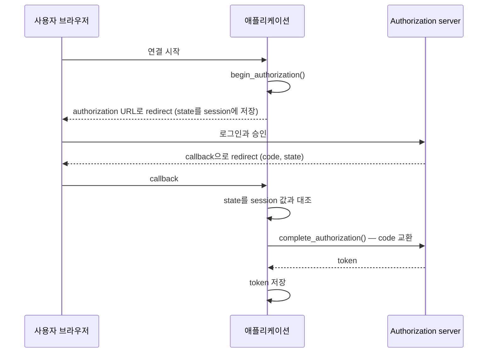

# OAuth client (외부 API 호출)

> `spakky-oauth`로 사용자를 대신해 외부 API를 부를 token을 얻고, 갱신하고, 폐기하는 방법을 설명합니다.

`spakky-oauth`는 OAuth 2.0 public client입니다. Authorization code + PKCE로 사용자의 승인을 받아 token을 저장하고, 만료 전에 갱신합니다.

[`spakky-oidc`](security.md#oidc)와 방향이 반대입니다.

| 플러그인 | 방향 | 하는 일 |
| --- | --- | --- |
| `spakky-oidc` | 들어오는 요청 | 요청에 실린 bearer token을 검증해 `AuthContext`로 매핑 |
| `spakky-oauth` | 나가는 호출 | 외부 API에 보낼 token을 사용자별로 얻어 보관 |

두 플러그인은 서로 의존하지 않습니다. 애플리케이션 로그인은 `spakky-oidc`로, 외부 서비스 연결은 `spakky-oauth`로 따로 구성합니다.

## 설치와 로드

```bash
pip install spakky-oauth
```

`spakky-oauth`는 `OAuthConfig`와 `OAuthClient`만 등록합니다. Token 저장소와 authorization state 저장소는 애플리케이션이 Pod로 등록합니다.

```python
from spakky.core.application.application import SpakkyApplication
from spakky.core.application.application_context import ApplicationContext
from spakky.core.pod.annotations.pod import Pod

import spakky.plugins.oauth
from spakky.plugins.oauth.store import (
    InMemoryOAuthAuthorizationStateStore,
    InMemoryOAuthTokenStore,
)


@Pod()
class DevTokenStore(InMemoryOAuthTokenStore): ...


@Pod()
class DevStateStore(InMemoryOAuthAuthorizationStateStore): ...


app = (
    SpakkyApplication(ApplicationContext())
    .load_plugins(include={spakky.plugins.oauth.PLUGIN_NAME})
    .add(DevTokenStore)
    .add(DevStateStore)
    .start()
)
```

In-memory 저장소는 개발과 테스트용입니다. Process가 재시작하면 token이 사라지고 만료된 authorization을 지우지 않습니다. 운영 저장소는 [저장소 구현](#token-stores)을 봅니다.

## Client 등록

`OAuthConfig`는 `SPAKKY_OAUTH__` prefix의 환경 변수에서 이름별 registration을 읽습니다.

```bash
export SPAKKY_OAUTH__CLIENTS='{
  "example": {
    "authorization_endpoint": "https://auth.example.test/authorize",
    "token_endpoint": "https://auth.example.test/token",
    "revocation_endpoint": "https://auth.example.test/revoke",
    "client_id": "my-app",
    "scopes": ["openid", "offline_access"],
    "token_parameters": {"resource": "https://api.example.test"}
  }
}'
```

| `OAuthClientRegistration` field | 기본값 | 책임 |
| --- | --- | --- |
| `authorization_endpoint` | 필수 | 사용자를 보낼 authorization URL |
| `token_endpoint` | 필수 | code 교환과 refresh endpoint |
| `revocation_endpoint` | `None` | 없으면 `revoke()`는 local token만 삭제 |
| `client_id` | 필수 | public client id |
| `scopes` | `()` | 요청할 scope |
| `authorization_parameters` | `{}` | authorization 요청에 더할 parameter |
| `token_parameters` | `{}` | code 교환과 refresh 요청에 더할 parameter |

| `OAuthConfig` field | 기본값 | 책임 |
| --- | --- | --- |
| `clients` | `{}` | 이름별 registration |
| `http_timeout_seconds` | `20.0` | token·revocation 요청 timeout |
| `refresh_leeway_seconds` | `90.0` | 만료 이만큼 전에 갱신 |
| `authorization_ttl_seconds` | `600.0` | 시작한 authorization이 callback을 기다리는 시간 |

Endpoint는 `https`여야 하고 loopback host에 한해 `http`를 허용합니다. Fragment가 있는 endpoint와, `client_id`·`state`·`code_verifier` 같은 protocol field를 덮어쓰는 추가 parameter는 거절합니다.

## 로그인 흐름

로그인과 callback route는 플러그인에 없습니다. 애플리케이션의 inbound adapter(FastAPI 등)가 아래 세 지점에서 `OAuthClient`를 호출합니다.



```python
from spakky.core.stereotype.usecase import UseCase

from spakky.plugins.oauth.client import OAuthClient


@UseCase()
class ExternalAccountConnection:
    def __init__(self, oauth: OAuthClient) -> None:
        self._oauth = oauth

    async def start(self, user_id: str) -> tuple[str, str]:
        request = await self._oauth.begin_authorization(
            "example",
            user_id,
            "https://app.example.test/auth/callback",
        )
        # url로 redirect하고, state는 이 사용자의 브라우저 session에 저장합니다.
        return request.url, request.state

    async def finish(self, session_state: str, state: str, code: str) -> None:
        if state != session_state:
            raise PermissionError("callback이 이 session에서 시작한 요청이 아닙니다.")
        await self._oauth.complete_authorization(state, code)
```

`begin_authorization()`은 `state`, PKCE `S256` challenge를 만들고, `scopes`에 `openid`가 있으면 `nonce`도 만듭니다. `complete_authorization()`은 `state`를 한 번만 받아들이고 `authorization_ttl_seconds`가 지나면 거절합니다.

!!! warning "Callback은 로그인한 session에 묶어야 합니다"
    `complete_authorization()`은 `state`만으로 주체를 찾습니다. Callback에서 받은 `state`가 이 브라우저 session에서 시작한 값인지 애플리케이션이 확인하지 않으면, 공격자가 자기 계정으로 시작한 URL을 피해자에게 열게 해 피해자의 token을 공격자 계정 아래 저장할 수 있습니다.

### ID token

`complete_authorization()`의 결과에는 `tokens.id_token`과 `nonce`가 들어 있습니다. `spakky-oauth`는 ID token의 서명과 claim을 검증하지 않습니다. 외부 계정의 신원을 신뢰해야 한다면 애플리케이션이 issuer의 JWKS로 서명을 확인하고 `nonce`, `aud`, `iss`를 대조합니다.

### Sign-in마다 client id를 발급하는 server

Callback이 실제 client id를 돌려주는 server는 그 값을 `complete_authorization()`에 넘깁니다. 이 값은 token과 함께 저장되어 이후 갱신에 쓰입니다. 요청별 추가 parameter는 `begin_authorization()`의 `parameters`로 넘깁니다.

```python
request = await oauth.begin_authorization(
    "example",
    user_id,
    redirect_uri,
    parameters={"login_hint": "user@example.test"},
)
result = await oauth.complete_authorization(state, code, client_id=issued_client_id)
```

## Token 사용

```python
from spakky.plugins.oauth.error import OAuthAuthorizationRequiredError

try:
    token = await oauth.access_token("example", user_id)
except OAuthAuthorizationRequiredError:
    ...  # 사용자를 다시 로그인 흐름으로 보냅니다.
```

`access_token()`은 다음 순서로 동작합니다.

1. 저장된 token이 `refresh_leeway_seconds`보다 오래 유효하면 그대로 돌려줍니다. Server가 수명을 알려주지 않은 token은 거절되기 전까지 유효한 것으로 봅니다.
2. 만료가 가까우면 refresh token으로 갱신하고, server가 새 refresh token을 주면 교체합니다.
3. 같은 주체의 동시 호출은 한 번만 갱신합니다.

외부 API가 token을 401로 거절하면 그 token을 넘겨 한 번 더 요청합니다. 저장된 token이 이미 다른 token으로 바뀌었다면 갱신하지 않고 새 token을 돌려줍니다.

```python
token = await oauth.access_token("example", user_id, rejected_token=token)
```

### 갱신이 실패했을 때

| Server 응답 | 결과 | 저장된 token |
| --- | --- | --- |
| `error="invalid_grant"` | `OAuthAuthorizationRequiredError` | 유지 |
| 그 밖의 4xx/5xx | `OAuthTokenEndpointError` | 유지 |
| 연결 실패 | `OAuthTransportError` | 유지 |

`access_token()`은 어떤 경우에도 저장된 token을 지우지 않습니다. 설정 실수나 일시적 장애로 사용자가 로그아웃되지 않게 하고, 다른 instance가 방금 갱신해 저장하려는 token을 지우지 않기 위해서입니다. 다시 로그인시키기 전에 저장분을 비우려면 `revoke()`를 호출합니다.

## 연결 해제

```python
await oauth.revoke("example", user_id)
```

`revoke()`는 local token을 먼저 지우고 `revocation_endpoint`에 폐기를 요청합니다. Server에 닿지 못했거나 server가 확인하지 않으면 `OAuthRevocationError`를 올리지만, 이 시점에 사용자는 이미 애플리케이션에서 연결 해제된 상태입니다.

## 저장소 구현 { #token-stores }

운영에서는 두 port를 database나 cache로 구현합니다.

| Port | 책임 |
| --- | --- |
| `IOAuthTokenStore` | `(client, subject)`별 `OAuthTokenSet` 저장·조회·삭제 |
| `IOAuthAuthorizationStateStore` | callback을 기다리는 authorization 저장, `take()`로 한 번만 꺼내기 |

!!! warning "`SecretStr`은 그대로 직렬화되지 않습니다"
    `OAuthTokenSet`과 `OAuthPendingAuthorization`의 token과 `code_verifier`는 `SecretStr`입니다. `model_dump_json()`은 이 값을 `**********`로 바꾸므로 그대로 저장하면 token을 잃습니다. 저장소 구현은 `get_secret_value()`로 값을 꺼내 직접 직렬화하고, 저장 시 암호화도 책임집니다.

여러 instance가 같은 저장소를 쓰는 경우의 동작입니다.

- 갱신 잠금은 process 안에서만 동작합니다. 두 instance가 같은 주체를 동시에 갱신하면 server는 한쪽만 받아들입니다.
- 거절된 쪽은 저장소를 다시 읽어, 다른 instance가 이미 새 token을 저장했으면 그 token을 씁니다. 아직 저장 전이면 `OAuthAuthorizationRequiredError`가 나고, 다음 호출은 저장된 새 token으로 성공합니다.
- 이 동작은 best-effort입니다. 분산 잠금이 필요하면 저장소 구현에서 제공합니다.

## 에러

| 에러 | 의미 |
| --- | --- |
| `OAuthClientNotConfiguredError` | 이름에 해당하는 registration이 없음 |
| `OAuthAuthorizationRequestError` | 요청별 parameter가 protocol field를 덮어쓰거나 `client_id` override가 비어 있음 |
| `OAuthAuthorizationStateError` | callback `state`를 모르거나 이미 썼거나 만료됨 |
| `OAuthAuthorizationRequiredError` | token이 없거나 server가 `invalid_grant`로 답해 다시 로그인해야 함 |
| `OAuthTokenEndpointError` | token endpoint가 `invalid_grant`가 아닌 이유로 실패 |
| `OAuthTokenResponseError` | token 응답이 사용할 수 있는 bearer token이 아님 |
| `OAuthTransportError` | authorization server에 연결하지 못함 |
| `OAuthRevocationError` | local token은 삭제했지만 server가 폐기를 확인하지 않음 |

## 범위 밖

- 로그인·callback HTTP route
- ID token 서명·claim 검증
- Confidential client 인증(`client_secret`), device code, client credentials grant
- Process 간 분산 잠금

## 함께 보기

- [LLM 모델 라우팅 — OpenAI Responses API와 ChatGPT 로그인](llm-routing.md#openai-responses-chatgpt): `OAuthClient`로 얻은 token을 LLM 호출에 쓰기
- [API reference](../api/plugins/spakky-oauth.md)
- [에러 계층](../error-hierarchy.md#spakky-oauth)
