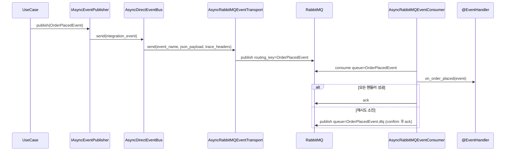

# RabbitMQ 통합

> `spakky-rabbitmq`는 `IEventTransport` 인터페이스를 통해 Integration Event를 RabbitMQ로 전송하고, 백그라운드 Consumer로 수신합니다.
> `AbstractIntegrationEvent.event_name` 값을 큐/라우팅 키로 사용하므로 발행자와 소비자가 같은 이벤트 타입 계약을 공유해야 합니다.

---

## 동작 원리

1. `@EventHandler`의 `@on_event` 메서드가 `RabbitMQPostProcessor`에 의해 Consumer에 자동 등록
2. Integration Event 발행 시 `RabbitMQEventTransport`가 RabbitMQ 큐로 전송
3. `RabbitMQEventConsumer`가 백그라운드 서비스로 구독자마다 큐 하나를 소비하며 핸들러에 dispatch
4. 실패한 핸들러는 `retry` 설정에 따라 재시도하고, 끝내 실패한 메시지는 그 구독자의 dead-letter 큐로 이동

핸들러 실행·재시도·dead-letter·redrive 규칙은 모든 브로커가 공유하는 [Integration Event 전달 계약](events.md#integration-event-전달-계약)을 따릅니다. 이 문서는 그 계약이 RabbitMQ에서 어떤 큐와 동작으로 구현되는지를 설명합니다.

---

## 설정

`RabbitMQConnectionConfig`는 `@Configuration`이므로 환경변수에서 자동 로딩됩니다.
발행 예제는 `IAsyncEventPublisher`와 event bus를 사용하므로 `spakky-rabbitmq`와 함께 `spakky-event`를 설치하고 로드해야 합니다. RabbitMQ만 쓴다면 `pip install "spakky[events-rabbitmq]"`가 가장 가볍습니다. RabbitMQ, Kafka, Outbox를 한 번에 실험하려면 `pip install "spakky[event-driven]"`를 사용하세요.

```python
from spakky.core.application.application import SpakkyApplication
from spakky.core.application.application_context import ApplicationContext
import spakky.event
import spakky.plugins.rabbitmq
import apps

app = (
    SpakkyApplication(ApplicationContext())
    .load_plugins(include={
        spakky.event.PLUGIN_NAME,
        spakky.plugins.rabbitmq.PLUGIN_NAME,
    })
    .scan(apps)
    .start()
)
```

환경변수 예시:

```bash
export SPAKKY_RABBITMQ__USE_SSL=false
export SPAKKY_RABBITMQ__HOST=localhost
export SPAKKY_RABBITMQ__PORT=5672
export SPAKKY_RABBITMQ__USER=guest
export SPAKKY_RABBITMQ__PASSWORD=guest
export SPAKKY_RABBITMQ__EXCHANGE_NAME=my-exchange  # Optional
export SPAKKY_RABBITMQ__AUTH_CHALLENGE_ACTION=ack
export SPAKKY_RABBITMQ__AUTH_DENY_ACTION=ack
export SPAKKY_RABBITMQ__DECLARE_DEFAULT_QUEUE=true  # Optional
export SPAKKY_RABBITMQ__RETRY__MAX_ATTEMPTS=3      # Optional
export SPAKKY_RABBITMQ__RETRY__INITIAL_INTERVAL=1.0
export SPAKKY_RABBITMQ__RETRY__MULTIPLIER=2.0
export SPAKKY_RABBITMQ__RETRY__MAX_INTERVAL=60.0
export SPAKKY_RABBITMQ__RETRY__MODE=blocking
export SPAKKY_RABBITMQ__AUTH_ERROR_ACTION=nack_requeue
```

| 필드 | 환경변수 | 기본값 | 설명 |
|------|---------|--------|------|
| `use_ssl` | `SPAKKY_RABBITMQ__USE_SSL` | (필수) | SSL 사용 여부 |
| `host` | `SPAKKY_RABBITMQ__HOST` | (필수) | RabbitMQ 호스트 |
| `port` | `SPAKKY_RABBITMQ__PORT` | (필수) | RabbitMQ 포트 |
| `user` | `SPAKKY_RABBITMQ__USER` | (필수) | 인증 사용자명 |
| `password` | `SPAKKY_RABBITMQ__PASSWORD` | (필수) | 인증 비밀번호 |
| `exchange_name` | `SPAKKY_RABBITMQ__EXCHANGE_NAME` | `None` | Exchange 이름 (event_name routing key 라우팅). 이름 있는 구독자를 쓰려면 필수 |
| `declare_default_queue` | `SPAKKY_RABBITMQ__DECLARE_DEFAULT_QUEUE` | `true` | 발행 시 이벤트 이름 큐(이름 없는 구독자의 큐)를 선언·바인딩할지 여부 |
| `retry.max_attempts` | `SPAKKY_RABBITMQ__RETRY__MAX_ATTEMPTS` | `1` | 첫 시도를 포함한 총 시도 횟수 |
| `retry.initial_interval` | `SPAKKY_RABBITMQ__RETRY__INITIAL_INTERVAL` | `0.0` | 두 번째 시도 전 대기(초) |
| `retry.multiplier` | `SPAKKY_RABBITMQ__RETRY__MULTIPLIER` | `2.0` | 실패할 때마다 대기에 곱하는 배수 |
| `retry.max_interval` | `SPAKKY_RABBITMQ__RETRY__MAX_INTERVAL` | `60.0` | 대기의 상한(초) |
| `retry.mode` | `SPAKKY_RABBITMQ__RETRY__MODE` | `blocking` | `blocking`(순서 유지) 또는 `delayed`(대기 큐 사용) |
| `auth_challenge_action` | `SPAKKY_RABBITMQ__AUTH_CHALLENGE_ACTION` | `ack` | missing/invalid/expired snapshot 처리 |
| `auth_deny_action` | `SPAKKY_RABBITMQ__AUTH_DENY_ACTION` | `ack` | protected handler DENY 처리 |
| `auth_error_action` | `SPAKKY_RABBITMQ__AUTH_ERROR_ACTION` | `nack_requeue` | verifier/provider ERROR 처리 |

`*_action` 값은 `ack`, `nack_requeue`, `nack_drop` 중 하나입니다. 기본 정책은 CHALLENGE/DENY를 ack하여 poison-loop를 피하고, ERROR는 requeue하여 일시적인 verifier/provider 장애를 재시도합니다.

!!! warning "제거된 설정: `malformed_payload_action`"
    `malformed_payload_action`(`SPAKKY_RABBITMQ__MALFORMED_PAYLOAD_ACTION`)은 제거되었습니다. 역직렬화할 수 없는 payload는 설정과 무관하게 재시도 없이 그 구독자의 dead-letter 큐로 이동합니다. 환경에 이 변수가 남아 있어도 무시됩니다.

---

## 이벤트 발행

Integration Event를 발행하면 `EventPublisher`가 `IEventBus`를 통해 `RabbitMQEventTransport`로 전달합니다.

```python
from uuid import UUID
from spakky.core.common.mutability import immutable
from spakky.domain.models.event import AbstractIntegrationEvent

@immutable
class OrderPlacedEvent(AbstractIntegrationEvent):
    order_id: UUID
    total_amount: float
```

```python
from spakky.core.stereotype.usecase import UseCase
from spakky.event.event_publisher import IAsyncEventPublisher

@UseCase()
class PlaceOrderUseCase:
    _publisher: IAsyncEventPublisher

    def __init__(self, publisher: IAsyncEventPublisher) -> None:
        self._publisher = publisher

    async def execute(self, order_id: UUID, total: float) -> None:
        event = OrderPlacedEvent(order_id=order_id, total_amount=total)
        await self._publisher.publish(event)
```

---

## 이벤트 수신

`@EventHandler`와 `@on_event`로 수신 핸들러를 정의합니다. `RabbitMQPostProcessor`가 자동으로 Consumer에 등록합니다.

```python
from spakky.event.stereotype.event_handler import EventHandler, on_event

@EventHandler()
class OrderEventHandler:
    @on_event(OrderPlacedEvent)
    async def on_order_placed(self, event: OrderPlacedEvent) -> None:
        print(f"주문 접수: {event.order_id}, 금액: {event.total_amount}")
```

큐 이름은 이벤트 인스턴스의 `event_name`에서 자동 결정됩니다. 기본값은 이벤트 클래스명(예: `OrderPlacedEvent`)이며, custom `event_name` property를 오버라이드하면 발행 routing key와 소비 queue 이름이 함께 그 값을 사용합니다. `subscriber`를 지정하지 않은 핸들러는 이벤트 이름과 같은 큐를 소비합니다.

### 구독자와 큐

`@EventHandler(subscriber=...)`로 구독자를 지정하면 구독자마다 전용 큐를 갖고, 같은 이벤트를 각자 한 부씩 받습니다. 한 구독자의 실패나 지연은 다른 구독자의 큐에 영향을 주지 않습니다.

```python
@EventHandler(subscriber="billing")
class BillingHandler:
    @on_event(OrderPlacedEvent)
    async def charge(self, event: OrderPlacedEvent) -> None: ...


@EventHandler(subscriber="shipping")
class ShippingHandler:
    @on_event(OrderPlacedEvent)
    async def reserve(self, event: OrderPlacedEvent) -> None: ...
```

| 자원 | 이름 없는 구독자 | 구독자 `billing` | 용도 |
|------|------------------|------------------|------|
| 소비 큐 | `<event_name>` | `<event_name>.billing` | 구독자가 소비하는 durable 큐. exchange가 있으면 routing key `<event_name>`으로 바인딩 |
| 대기 큐 | `<event_name>.retry` | `<event_name>.billing.retry` | `delayed` 재시도 사본이 기다리는 durable 큐. `retry.mode=delayed`일 때만 선언 |
| dead-letter 큐 | `<event_name>.dlq` | `<event_name>.billing.dlq` | 구독자가 포기한 메시지를 보관하는 durable 큐 |

- 이름 있는 구독자는 `exchange_name`이 필수입니다. 기본 exchange는 routing key와 이름이 같은 큐 하나에만 전달하므로 구독자별 사본을 만들 수 없습니다. exchange 없이 이름 있는 구독자를 등록하면 기동 시 `SubscriberExchangeRequiredError`가 납니다.
- 큐·exchange·바인딩은 Consumer가 기동할 때 선언합니다. 이름 있는 구독자의 큐는 Consumer가 한 번 기동한 뒤부터 메시지를 받으므로, 발행 서비스보다 소비 서비스를 먼저 배포하세요.
- 발행 Transport는 기본적으로 이벤트 이름 큐(이름 없는 구독자의 큐)를 선언하고 바인딩합니다. 어떤 이벤트의 소비자가 모두 이름 있는 구독자라면 이 큐에는 아무도 소비하지 않는 메시지가 쌓이므로, 발행 서비스에서 `SPAKKY_RABBITMQ__DECLARE_DEFAULT_QUEUE=false`로 끄세요. 이 값을 끄면 Transport는 큐를 만들지 않으므로, 소비 큐가 아직 없을 때 발행한 메시지는 브로커가 버립니다.
- 한 구독(구독자와 이벤트 타입의 쌍)의 핸들러는 모두 동기이거나 모두 비동기여야 합니다. 동기·비동기 Consumer가 같은 큐를 나눠 소비하게 되기 때문입니다.
- `<event_name>.<구독자>` 형태의 큐 이름이 다른 이벤트의 `event_name`과 겹치지 않도록 이벤트 이름을 정하세요.

!!! note "`partition_key`는 RabbitMQ 라우팅에 사용되지 않습니다"
    `AbstractIntegrationEvent.partition_key`는 `IEventTransport` 계약의 일부라 RabbitMQ transport에도 전달되지만, RabbitMQ에는 파티션 개념이 없고 단일 queue는 이미 FIFO 순서이므로 **라우팅에 반영되지 않습니다.** 이 값을 오버라이드해도 exchange·routing key·발행 결과는 그대로이며, 경고나 예외도 발생하지 않습니다. 파티션 키로 순서를 제어하려면 Kafka transport를 사용하십시오.

---

## 운영 흐름

발행 경로는 `IAsyncEventPublisher`에서 시작하지만, RabbitMQ transport가 직접 도메인 객체를 직렬화하지는 않습니다. `AsyncDirectEventBus`가 `TypeAdapter(type(event)).dump_json(event)`로 JSON bytes payload를 만들고, `AsyncRabbitMQEventTransport`가 이벤트 이름과 payload를 RabbitMQ에 씁니다. 동기 경로에서는 같은 역할을 `DirectEventBus`와 `RabbitMQEventTransport`가 수행합니다.



실무에서는 아래 규칙을 맞춥니다.

| 항목 | 규칙 |
|------|------|
| 이벤트 이름 | `AbstractIntegrationEvent.event_name` 값, 기본은 클래스명 |
| 큐 이름 | 이름 없는 구독자는 `event_name`, 이름 있는 구독자는 `<event_name>.<구독자>`. durable queue로 선언 |
| payload | Pydantic `TypeAdapter`가 만든 JSON bytes |
| headers | `ITracePropagator.inject()`가 넣은 trace header와 signed `AuthContextSnapshot` metadata |
| exchange 없음 | 기본 exchange에 큐 이름 routing key로 발행 |
| exchange 있음 | configured exchange에 이벤트 이름 routing key로 발행하고, 구독자 큐를 같은 routing key로 bind |

`spakky-outbox`를 함께 로드하면 `OutboxEventBus` / `AsyncOutboxEventBus`가 `@Primary`로 기본 bus를 대체합니다. 이 경우 UseCase 안의 `publish()` 호출은 RabbitMQ에 즉시 전송되지 않고 Outbox 테이블에 저장되며, Relay 실행 시점에 RabbitMQ transport의 `send()`가 호출됩니다. 비즈니스 데이터와 메시지 저장을 같은 DB 트랜잭션에 묶어야 하면 Outbox를 사용하세요.

---

## Exchange 라우팅

`exchange_name`을 설정하면 configured exchange에 이벤트 이름을 routing key로 사용합니다.

- Transport와 Consumer가 같은 exchange를 같은 속성(direct, non-durable)으로 선언
- Transport는 `declare_default_queue`가 켜져 있으면 이벤트 이름과 같은 durable queue를 선언하고 바인딩
- Consumer는 구독자 큐마다 routing key `event_name`으로 바인딩하므로, 같은 이벤트를 구독자 수만큼 복제해 전달
- 발행 시 `event_name` routing key로 publish

`exchange_name`이 `None`이면 기본 exchange(direct)를 사용합니다. 기본 exchange는 이벤트 이름과 같은 큐 하나에만 전달하므로 이름 없는 구독자만 쓸 수 있습니다.

같은 이름의 exchange가 다른 타입이나 durable 속성으로 이미 있으면 선언이 실패합니다. exchange는 non-durable이라 브로커가 재시작하면 바인딩과 함께 사라지며, Consumer가 다시 기동할 때 다시 선언됩니다. 큐와 그 안의 persistent 메시지는 남습니다.

---

## 재시도

`retry` 설정(`RetryPolicy`)은 구독자 큐마다 독립적으로 적용됩니다. 한 구독자 안에서 핸들러 하나가 실패해도 나머지는 모두 실행하고, 재시도는 아직 성공하지 못한 핸들러만 다시 실행합니다. 기본값은 `max_attempts=1`이라 재시도 없이 바로 dead-letter 큐로 갑니다.

### `blocking` — 순서 유지

실패한 메시지를 ack하지 않은 채 `delay`만큼 기다렸다가 같은 메시지를 다시 전달합니다.

- 이 모드에서는 Consumer가 prefetch를 1로 설정하므로, 기다리는 동안 같은 큐의 다음 메시지는 전달되지 않습니다. 구독자 큐 안의 순서가 유지됩니다.
- 다른 구독자의 큐는 기다리지 않고 계속 소비됩니다.
- 대기 중에도 연결의 heartbeat는 계속 처리됩니다. 서비스가 멈추면 대기를 끝내고 메시지를 브로커에 되돌립니다.
- 재시도 진행 상태(시도 횟수, 남은 핸들러)는 프로세스 메모리에 있습니다. 프로세스가 재시작하면 그 메시지는 첫 시도로 다시 전달되고 모든 핸들러가 다시 실행됩니다.
- prefetch 1은 큐마다 한 번에 한 메시지만 처리한다는 뜻입니다. 처리량이 순서보다 중요하면 `delayed`를 쓰세요.

### `delayed` — 대기 큐

실패한 메시지의 사본을 구독자의 대기 큐(`<소비 큐>.retry`)에 넣고 원본을 ack한 뒤 다음 메시지를 바로 처리합니다. 순서는 보장하지 않습니다.

- 사본은 원래 본문과 헤더에 `x-spakky-delivery-attempt`(다음 시도 번호), `x-spakky-delivery-pending-handlers`(남은 핸들러) 헤더를 더하고, `delay`를 메시지 TTL로 설정합니다.
- 대기 큐는 만료된 메시지를 exchange가 아니라 기본 exchange를 통해 **그 구독자의 소비 큐로만** 되돌립니다. 같은 이벤트의 다른 구독자는 재시도 메시지를 받지 않습니다.
- 원본은 브로커가 사본을 확인(publisher confirm)한 뒤에만 ack합니다. 확인되지 않으면 원본을 requeue합니다.
- 이 모드에서는 prefetch를 제한하지 않습니다.

!!! note "대기 큐의 head-of-line 지연"
    구독자마다 대기 큐가 하나이고 지연은 메시지별 TTL로 겁니다. RabbitMQ는 큐의 맨 앞 메시지만 만료시키므로, 지연이 긴 메시지가 앞에 있으면 뒤의 지연이 짧은 메시지도 앞 메시지가 만료될 때까지 기다립니다. 즉 재시도는 설정한 지연 **이상** 기다리며, 지연이 서로 다른 메시지(다른 시도 차수, `EventDeferredError`의 `retry_after`)가 섞이면 최대 `max_interval`(또는 가장 긴 `retry_after`)만큼 늦어질 수 있습니다. 지연을 일정하게 유지하려면 `multiplier=1`로 고정 간격을 쓰세요.

### 재시도하지 않는 경우

- `AbstractNonRetryableEventError`를 상속한 예외: 남은 횟수와 상관없이 바로 dead-letter 큐로 갑니다.
- 역직렬화할 수 없는 payload, 해석할 수 없는 재시도 상태 헤더: 핸들러를 호출하지 않고 바로 dead-letter 큐로 갑니다.
- `EventDeferredError(retry_after)`: 시도 횟수를 세지 않고 `retry_after`만큼 기다렸다가 다시 전달합니다. `blocking`에서는 제자리에서, `delayed`에서는 대기 큐에서 기다립니다.

---

## Dead-letter 큐

구독자가 포기한 메시지는 그 구독자의 dead-letter 큐(`<소비 큐>.dlq`)로 이동합니다. 메시지는 원래 본문과 문자열 헤더에 아래 헤더를 더한 persistent 메시지입니다. `DeadLetter.from_headers()`로 복원할 수 있습니다.

| 헤더 | 내용 |
|------|------|
| `x-spakky-dead-letter-original-destination` | 원래 발행된 이벤트 이름 |
| `x-spakky-dead-letter-subscriber` | 구독자 이름(이름 없는 구독자는 빈 문자열) |
| `x-spakky-dead-letter-failures` | 실패한 핸들러별 이름·예외 종류·메시지·재시도 가능 여부(JSON) |
| `x-spakky-dead-letter-attempts` | 시도 횟수 |
| `x-spakky-dead-letter-failed-at` | 마지막 시도가 끝난 시각(ISO 8601) |

원본은 브로커가 dead-letter 사본을 확인한 뒤에만 ack합니다. 확인되지 않으면 원본을 requeue하므로 메시지를 잃지 않습니다. 대신 같은 메시지가 dead-letter 큐에 두 번 들어갈 수 있으니, 부작용이 있는 핸들러는 [멱등 소비](events.md#멱등-소비)를 함께 쓰세요.

재시도·dead-letter 사본에는 문자열(또는 bytes) 값 헤더만 옮겨집니다.

### Redrive

`RabbitMQEventConsumer`는 `IEventRedriver`를, `AsyncRabbitMQEventConsumer`는 `IAsyncEventRedriver`를 구현합니다. Redrive는 dead letter를 남긴 구독자에게만 전달하고, 실패로 기록된 핸들러만 실행합니다. 같은 이벤트의 다른 구독자와 이미 성공한 핸들러는 다시 실행되지 않습니다.

```python
from spakky.event.redrive import IAsyncEventRedriver


async def retry_billing(redriver: IAsyncEventRedriver) -> None:
    result = await redriver.redrive(OrderPlacedEvent, subscriber="billing", limit=100)
    print(result.succeeded, result.failed)
```

- 해당 구독(구독자와 이벤트 타입)의 핸들러가 등록된 애플리케이션에서 호출해야 합니다. 등록되지 않았으면 `SubscriptionNotFoundError`가 납니다.
- 호출마다 전용 연결을 열어 dead-letter 큐에서 메시지를 꺼냅니다. `limit`을 생략하면 큐가 빌 때까지 꺼냅니다.
- dead letter마다 한 번만 시도합니다(`retry` 설정을 적용하지 않습니다). 성공하면 큐에서 지우고, 다시 실패하면 호출이 끝날 때 원래 메타데이터 그대로 큐에 되돌립니다. 따라서 한 번의 호출에서 같은 메시지를 반복해서 받지 않습니다.
- 인증 provider 장애는 예외로 전파되며, 그때까지 꺼낸 미확인 메시지는 큐에 남습니다.

---

## 분산 트레이싱

`spakky-tracing`은 `spakky-rabbitmq`의 필수 의존성입니다. 컨테이너에 `ITracePropagator`가 등록되어 있으면 메시지 헤더를 통해 `TraceContext`가 자동 전파됩니다.

- **발행 측**: `OutboxEventBus` 또는 `DirectEventBus`가 현재 `TraceContext`를 메시지 헤더에 주입. `SPAKKY_AUTH_SNAPSHOT_PROPAGATION_ENABLED=true`가 설정되어 있으면 raw bearer token 대신 signed `AuthContextSnapshot` metadata도 함께 주입
- **수신 측**: `RabbitMQEventConsumer`가 헤더에서 `TraceContext`를 추출하여 자식 span 생성
- 헤더가 없으면 새로운 루트 트레이스를 시작
- `ITracePropagator`가 컨테이너에 없으면 트레이싱은 비활성 상태로, 별도 에러 없이 동작합니다

별도 설정이나 코드 변경 없이, 플러그인 로드만으로 동작합니다.

---

## 인증/인가 snapshot 수신

`spakky-auth`의 보호 decorator가 붙은 RabbitMQ event handler는 signed `AuthContextSnapshot`을 검증한 뒤 `ApplicationContext` request/context scope에 `AuthContext`를 seed합니다. 이 작업은 `RabbitMQPostProcessor` wrapper가 기존 integration context를 `clear_context()`로 비운 직후, 사용자 handler 호출 전에 수행됩니다.

수신 측은 다음 header를 snapshot envelope로 인식합니다.

| header | 설명 |
|--------|------|
| `spakky.auth.context_snapshot` | Event/Outbox transport metadata key |
| `x-spakky-auth-context-snapshot` | HTTP/gRPC-style snapshot header key |

보호된 handler에서 snapshot이 없거나 invalid/expired이면 `CHALLENGE`로 fail-closed 처리합니다. 정책 evaluator가 `DENY`를 반환해도 handler는 호출되지 않습니다. 검증 provider가 unavailable이면 `ERROR`로 처리하며, 기본 RabbitMQ 정책은 `nack_requeue`입니다.

인증 실패는 재시도 횟수에 포함되지 않으며, 설정한 action이 메시지에 다음과 같이 적용됩니다.

| action | 동작 |
|--------|------|
| `ack` | 거부된 handler만 건너뜁니다. 같은 구독자의 나머지 handler는 실행되고, 메시지는 그 결과에 따라 ack·재시도·dead-letter됩니다 |
| `nack_requeue` | 전달을 중단하고 메시지를 ack하지 않은 채 requeue합니다. 뒤의 handler는 실행되지 않으며, 메시지는 다시 전달될 때 처음부터 실행됩니다 |
| `nack_drop` | 거부된 handler를 건너뛰고, 나머지 handler가 모두 끝나면 ack 대신 requeue 없는 nack으로 메시지를 버립니다. 다른 handler가 실패하면 재시도·dead-letter 규칙이 우선합니다 |

`AuthVerificationProviderUnavailableError`, `AuthRequirementProviderUnavailableError`처럼 인증 기반 자체가 응답하지 못한 경우는 메시지에 대한 판정이 아니므로, 메시지를 ack하지 않고 requeue합니다. requeue된 메시지는 곧바로 다시 전달되므로 provider 장애가 길어지면 같은 메시지가 반복 전달됩니다.

Payload 직렬화, event name routing, trace header 추출 동작은 snapshot 검증과 독립적으로 유지됩니다.

---

## 이전 버전에서 달라진 점

- **`malformed_payload_action` 제거**: 역직렬화할 수 없는 payload는 항상 dead-letter 큐로 갑니다.
- **핸들러 예외 처리**: 이전에는 핸들러 예외가 Consumer 밖으로 전파되어 메시지가 미확인 상태로 남았습니다. 이제 `retry` 설정에 따라 재시도하고, 소진되면 `<소비 큐>.dlq`로 옮긴 뒤 ack합니다. Consumer가 기동할 때 구독자마다 dead-letter 큐를 새로 선언합니다.
- **핸들러 격리**: 같은 이벤트의 핸들러 하나가 실패하거나 인증에서 거부(`ack` 정책)되어도 나머지 핸들러는 실행됩니다.
- **기본 prefetch**: 기본 모드(`blocking`)에서 큐마다 prefetch 1을 설정합니다. 이전의 비동기 Consumer는 prefetch 제한 없이 한 큐의 메시지를 동시에 처리했습니다. 이전과 같은 동시 처리가 필요하면 `SPAKKY_RABBITMQ__RETRY__MODE=delayed`를 쓰세요.
- **Consumer의 exchange 선언·바인딩**: `exchange_name`이 있으면 Consumer도 exchange를 선언하고 자신의 큐를 바인딩합니다. 이전에는 Transport만 했습니다.
- **`register()` 시그니처**: `register(event, handler, *, subscriber=None, handler_name=None)`. Consumer의 `handlers`, `type_lookup`, `type_adapters` 속성은 없어졌습니다.
- **aspect가 적용된 핸들러 등록**: `@Transactional()`처럼 aspect가 적용되어 AOP proxy가 된 `@EventHandler`의 핸들러도 등록됩니다. 이전에는 등록에서 빠졌습니다.
